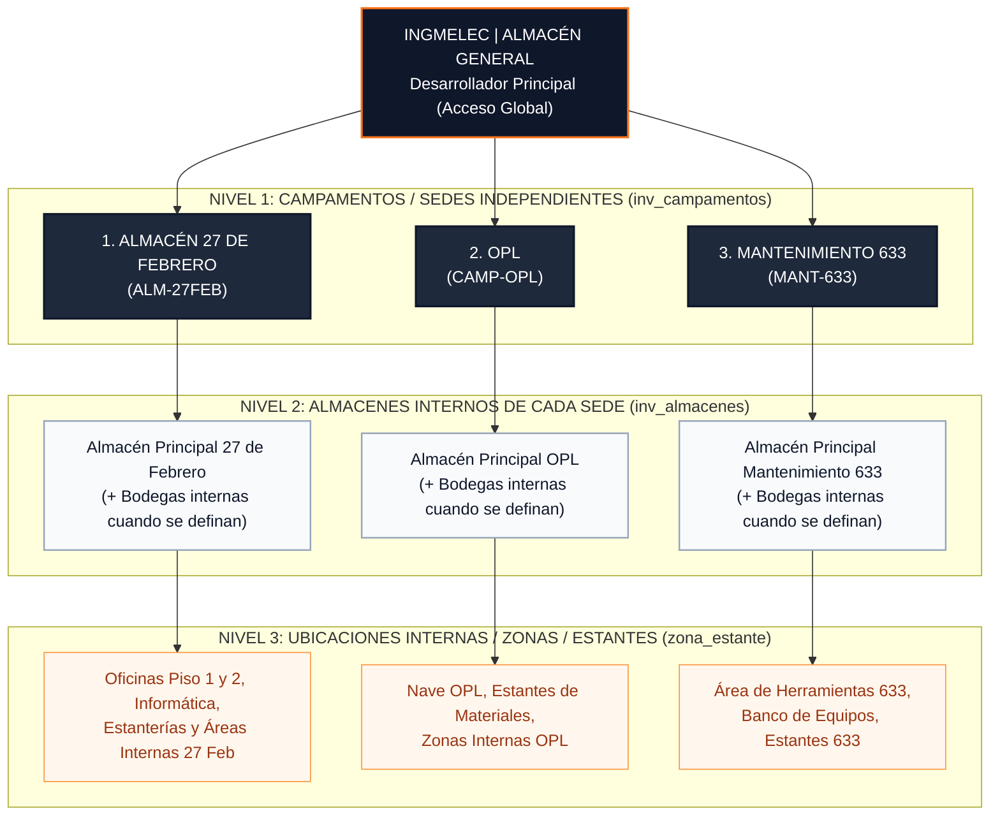

# ESTRUCTURA CORREGIDA DE CAMPAMENTOS INDEPENDIENTES Y TABLA DE EQUIVALENCIAS PARA REVISIÓN HUMANA

**Proyecto:** INGMELEC | ALMACÉN GENERAL
**Fecha de Emisión:** 4 de Noviembre de 2026
**Estado:** ESTRUCTURA CORREGIDA EN DISEÑO LOCAL — EN ESPERA DE REVISIÓN Y APROBACIÓN HUMANA
**Garantía de Integridad:** Cero escrituras en Clever Cloud | Cero reasignaciones automáticas de inventario | Cero modificaciones de ubicaciones históricas

---

## 1. CORRECCIÓN ARQUITECTÓNICA Y OPERATIVA

Se corrige formalmente la propuesta jerárquica anterior. Queda establecido como regla de arquitectura de **INGMELEC | ALMACÉN GENERAL** que las siguientes tres entidades son **TRES SEDES O CAMPAMENTOS OPERATIVOS ESTRICTAMENTE INDEPENDIENTES**:

1. **`ALMACÉN 27 DE FEBRERO`** (`Código: ALM-27FEB`)
2. **`OPL`** (`Código: CAMP-OPL`)
3. **`MANTENIMIENTO 633`** (`Código: MANT-633`)

> [!IMPORTANT]
> **REGLA DE INDEPENDENCIA TERRITORIAL:** En ningún caso se agrupan `OPL` ni `MANTENIMIENTO 633` dentro de `Campamento Base Central KM 19`. Cada una de estas tres sedes opera como un campamento autónomo de primer nivel en `inv_campamentos`.

---

## 2. AUTONOMÍA FUNCIONAL DE CADA CAMPAMENTO INDEPENDIENTE

Cada uno de los tres campamentos independientes (`ALMACÉN 27 DE FEBRERO`, `OPL`, `MANTENIMIENTO 633`), así como cualquier sede regional (`San Cristóbal`, `Azua`, `Pedernales`), cuenta con aislamiento y trazabilidad propia en los 6 pilares del sistema:

| Pilar Operativo | Tabla / Entidad en Base de Datos | Comportamiento por Campamento Independiente |
| :--- | :--- | :--- |
| **1. Registro de Campamento** | `inv_campamentos` | Registro único de nivel superior con su propio `id`, `nombre`, `codigo`, `provincia`, `direccion` y `responsable`. |
| **2. Almacenes Internos** | `inv_almacenes` (`campamento_id`) | Cada campamento posee sus propios almacenes o bodegas internas (cuando se definan), vinculados mediante clave foránea `campamento_id`. |
| **3. Inventario Propio** | `inv_articulos` (`campamento_id`, `almacen_id`, `ubicacion_nombre`) | Los activos pertenecen a su sede independiente sin mezclarse con otras sedes en las vistas operativas. |
| **4. Levantamientos Propios** | `inv_levantamientos` (`campamento_id`, `almacen_id`) | Las sesiones de auditoría física (`LEV-2026-[CODIGO]-XXX`) se abren, capturan y consolidan exclusivamente para el campamento correspondiente. |
| **5. Movimientos y Reportes** | `inv_movimientos` y `/api/almacen/reportes/*` | El kárdex transaccional (`ENTRADA`, `SALIDA`, `TRASLADO`, `ASIGNACION`, `DEVOLUCION`, `AJUSTE`) y las exportaciones se filtran por sede. |
| **6. Usuarios y Permisos por Sede** | `inv_usuario_campamentos`, `inv_usuario_almacenes`, `permisos_json` | Los usuarios operativos solo acceden al campamento(s) que el Desarrollador Principal les asigne. |

---

## 3. SEPARACIÓN ENTRE CAMPAMENTOS INDEPENDIENTES, ALMACENES INTERNOS Y UBICACIONES INTERNAS

Para evitar ambigüedades entre sedes y ubicaciones físicas dentro de una sede, el modelo distingue tres niveles estrictos:

### Detalle de los Tres Niveles:
1. **Nivel 1 — Campamento / Sede Independiente (`inv_campamentos`):**
   - Representa la unidad territorial y administrativa de primer nivel (`ALMACÉN 27 DE FEBRERO`, `OPL`, `MANTENIMIENTO 633`, `San Cristóbal`, `Azua`, `Pedernales`).
   - Determina la identidad visual del encabezado para los usuarios asignados (`INGMELEC | ALMACÉN [NOMBRE DEL CAMPAMENTO]`) y la frontera de seguridad de datos.
2. **Nivel 2 — Almacén Interno (`inv_almacenes`):**
   - Representa los almacenes o bodegas físicas **dentro** de un campamento independiente (`campamento_id`).
   - Cada campamento independiente tiene su almacén principal por defecto y admite tantos almacenes internos adicionales como se definan operativamente.
3. **Nivel 3 — Ubicación Interna (`inv_articulos.zona_estante` / `inv_levantamiento_items.ubicacion_exacta`):**
   - Representa la localización física granular dentro de un almacén o sede (ej. *Oficina Administrativa*, *Pasillo B - Estante 4*, *Contenedor 2*, *Cuarto de Servidores*).
   - Las ubicaciones internas **nunca** crean campamentos nuevos ni alteran la sede independiente a la que pertenece el artículo.

---

## 4. MODELO DE ACCESO Y CONTROL DE PERMISOS POR SEDE

En [`server/routes/almacenApi.js`](file:///c:/Users/gener/OneDrive/Desktop/ALMACEN%20INGMELEC/INGMELEC-DOMINICANA-main/INGMELEC-DOMINICANA-main/server/routes/almacenApi.js#L178-L208) (`getUserAllowedCampamentos`) y en los endpoints de consulta y escritura:

1. **Perfil `developer` (`INGMELEC | ALMACÉN GENERAL`):**
   - Único perfil con `isGlobal: true` de manera automática e irrestricta.
   - Visualiza y administra todos los campamentos independientes (`ALMACÉN 27 DE FEBRERO`, `OPL`, `MANTENIMIENTO 633` y sedes regionales), sus almacenes, inventarios, levantamientos, movimientos y reportes.
   - Es el **único** autorizado para crear usuarios, modificar permisos y asignarles qué sede(s) pueden operar.
2. **Usuarios Operativos (`admin`, `supervisor`, `auditor`, `almacen`, `gerencia`, `tecnico`, `consulta`):**
   - Tienen `isGlobal: false`.
   - Solamente tienen acceso a las sedes o campamentos que el Desarrollador Principal les haya asignado en `inv_usuario_campamentos` / `campamento_id`.
   - Cualquier intento de consultar o modificar inventario, levantamientos o movimientos de una sede no asignada es rechazado con `HTTP 403 Forbidden`.

---

## 5. REGISTRO EN DISEÑO LOCAL SIN DUPLICACIÓN

Se actualizó el script de migración [`server/database/migrate-levantamientos.js`](file:///c:/Users/gener/OneDrive/Desktop/ALMACEN%20INGMELEC/INGMELEC-DOMINICANA-main/INGMELEC-DOMINICANA-main/server/database/migrate-levantamientos.js#L31-L68) y la base de datos local aislada (`MariaDB 127.0.0.1:3308`) verificando registros equivalentes preexistentes para no crear duplicados:

| ID Local (`:3308`) | Nombre Oficial del Campamento Independiente | Código | Provincia | Responsable | Almacén Interno Asociado (`inv_almacenes`) | Acción Aplicada en Diseño Local |
| :---: | :--- | :---: | :--- | :--- | :--- | :--- |
| **3** | **`ALMACÉN 27 DE FEBRERO`** | `ALM-27FEB` | Distrito Nacional | Ronald Florentino | `Almacén Principal 27 de Febrero` (ID 3) | Homologado sobre el registro equivalente existente (`Almacén Central`) sin duplicar. |
| **12** | **`OPL`** | `CAMP-OPL` | Santo Domingo Oeste | Jonathan Hernández | `Almacén Principal OPL` (ID 16) | Creado como campamento independiente autónomo. |
| **13** | **`MANTENIMIENTO 633`** | `MANT-633` | Santo Domingo | William Almánzar | `Almacén Principal Mantenimiento 633` (ID 17) | Creado como campamento independiente autónomo. |
| **4** | **`San Cristóbal`** | `CAMP-SC` | San Cristóbal | Encargado Sede | `Almacén Principal San Cristóbal` (ID 4) | Conservado sin duplicar. |
| **5** | **`Azua`** | `CAMP-AZ` | Azua | Encargado Sede | `Almacén Principal Azua` (ID 5) | Conservado sin duplicar. |
| **6** | **`Pedernales`** | `CAMP-PED` | Pedernales | Encargado Sede | `Almacén Principal Pedernales` (ID 6) | Conservado sin duplicar. |

*(Nota: Los registros sintéticos `ID 1 Campamento Base Central Real` e `ID 2 Campamento San Cristóbal Real` se mantienen en MariaDB local únicamente como fixtures de las pruebas automatizadas Playwright).*

---

## 6. TABLA DE EQUIVALENCIAS PARA REVISIÓN HUMANA (ANTES DE CUALQUIER REDISTRIBUCIÓN DE INVENTARIO)

En estricto cumplimiento de sus instrucciones:
- **No se ha reasignado automáticamente ningún artículo.**
- **No se ha modificado ninguna ubicación histórica (`ubicacion_nombre`).**
- **No se ha ejecutado ninguna migración ni escritura sobre Clever Cloud.**

A continuación se presenta la **Tabla de Equivalencias entre las Ubicaciones Históricas del Levantamiento (Excel / Clever Cloud) y los Campamentos Independientes** para su revisión y decisión antes de aplicar cualquier redistribución de inventario:

### 6.1. Matriz de Equivalencias Propuesta

| # | Texto Histórico Exacto en `ubicacion_nombre` (Excel / Clever Cloud) | Desglose por Área Funcional | Total Artículos Excel (433) | Total Artículos Clever Cloud (434) | Unidades Físicas (Excel / CC) | Campamento Independiente Propuesto (`inv_campamentos`) | Código de Sede | Almacén Interno Propuesto (`inv_almacenes`) | Estado de Equivalencia / Decisión Requerida |
| :---: | :--- | :--- | :---: | :---: | :---: | :--- | :---: | :--- | :--- |
| **1** | **`DISTRITO NACIONAL 27 DE FEBRERO`** | • `INFORMATICA`: 17 (18 en CC con `INF-090`) • `OFICINAS`: 26 • `ALMACEN`: 41 | **84** | **85** | **350 / 355** | **`ALMACÉN 27 DE FEBRERO`** | `ALM-27FEB` | `Almacén Principal 27 de Febrero` | **Equivalencia Directa (1:1):** Todos los activos corresponden a la sede independiente **ALMACÉN 27 DE FEBRERO**. |
| **2** | **`KM 19 AUTOPISTA DUARTE OPL`** | • `ALMACEN`: 130 (Custodio: Jonathan Hernández) | **130** | **130** | **840 / 840** | **`OPL`** | `CAMP-OPL` | `Almacén Principal OPL` | **Equivalencia Directa (1:1):** Todos los activos corresponden a la sede independiente **OPL**. |
| **3** | **`MANTENIMIENTO 633`** | • `ALMACEN`: 109 (90 lote inicial + 19 adenda; Custodio: William Almánzar) | **109** | **109** | **599 / 587** | **`MANTENIMIENTO 633`** | `MANT-633` | `Almacén Principal Mantenimiento 633` | **Equivalencia Directa (1:1):** Todos los activos corresponden a la sede independiente **MANTENIMIENTO 633**. |
| **4** | **`KM 19 AUT DUARTE`** | • `INFORMATICA`: 67 (38 en Km 19 general + 29 terminales/equipos asignados a brigadas/técnicos) • `OFICINAS`: 43 (mobiliario y equipos de oficina en Km 19) | **110** | **110** | **182 / 182** | **PENDIENTE DE CONFIRMACIÓN HUMANA** *(Ver opciones A, B o C abajo)* | Por definir | Por definir | **Requiere Confirmación del Desarrollador Principal** antes de vincular estos 110 activos. |
| **5** | **`DISTRITO NACIONAL 27 DE FEBRETO`** *(Typo)* | • `ALMACEN`: Filas 196 a 250 en blanco (sin artículos) | **0** | **0** | **0 / 0** | *N/A (Sin activos)* | N/A | N/A | Error tipográfico en filas vacías del Excel. No afecta ningún activo real. |
| | **TOTAL CONSOLIDADO** | **4 Áreas** (`COCINA` = 0 reales) | **433** | **434** | **1,971 / 1,964** | | | | |

---

### 6.2. Punto Específico para su Decisión sobre el Grupo #4 (`KM 19 AUT DUARTE` — 110 activos de Informática y Oficinas)

Mientras que en la hoja `ALMACEN` del Excel los activos están claramente separados entre **`KM 19 AUTOPISTA DUARTE OPL`** (130 artículos de Jonathan Hernández) y **`MANTENIMIENTO 633`** (109 artículos de William Almánzar), en las hojas **`INFORMATICA`** (67 artículos) y **`OFICINAS`** (43 artículos) el levantamiento original registró la ubicación general **`KM 19 AUT DUARTE`**.

Antes de realizar cualquier asignación de `campamento_id`, indique cuál de las siguientes opciones autoriza para esos **110 activos (`KM 19 AUT DUARTE`)**:

- **Opción A:** Vincularlos a una cuarta sede independiente denominada **`KM 19 AUT DUARTE`** (o el nombre que usted indique para las oficinas/informática de Km 19), manteniendo a **`OPL`** y **`MANTENIMIENTO 633`** como sedes independientes separadas.
- **Opción B:** Distribuir esos 110 activos de Informática y Oficinas entre **`OPL`** y **`MANTENIMIENTO 633`** según el custodio/responsable asignado en cada fila (`William Almánzar`, `Jonathan Hernández`, `Daniel Durán`, etc.).
- **Opción C:** Asignar la totalidad de esos 110 activos a una de las sedes independientes existentes (**`OPL`** o **`MANTENIMIENTO 633`**), conservando el texto histórico original en trazabilidad.
