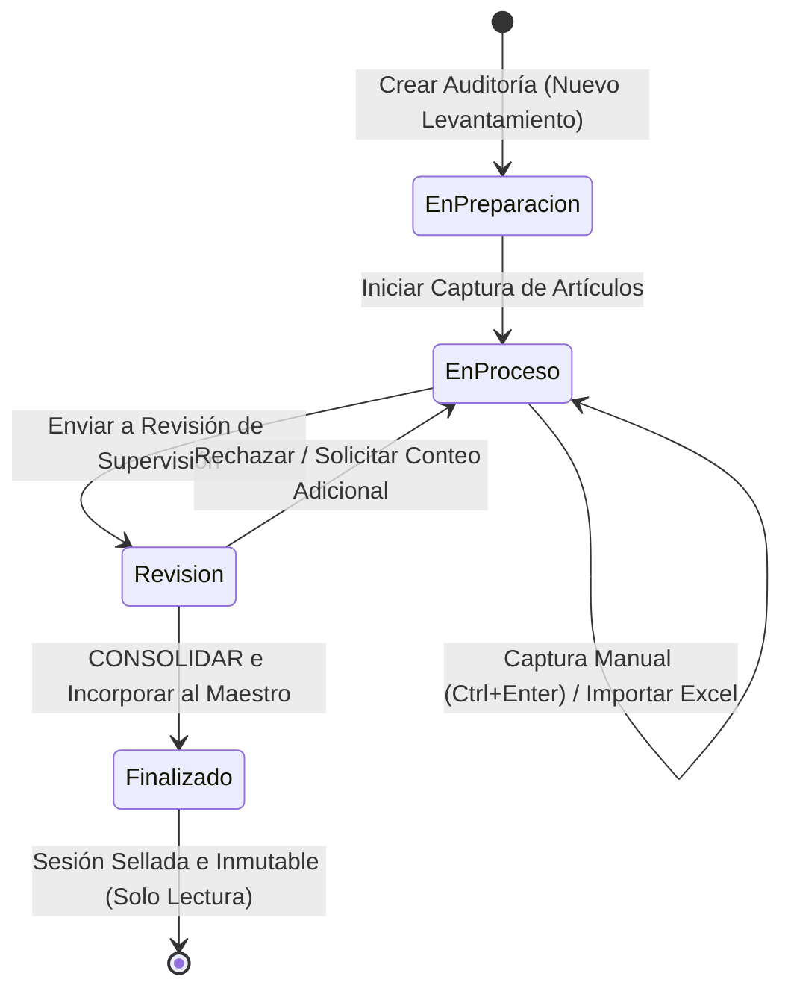
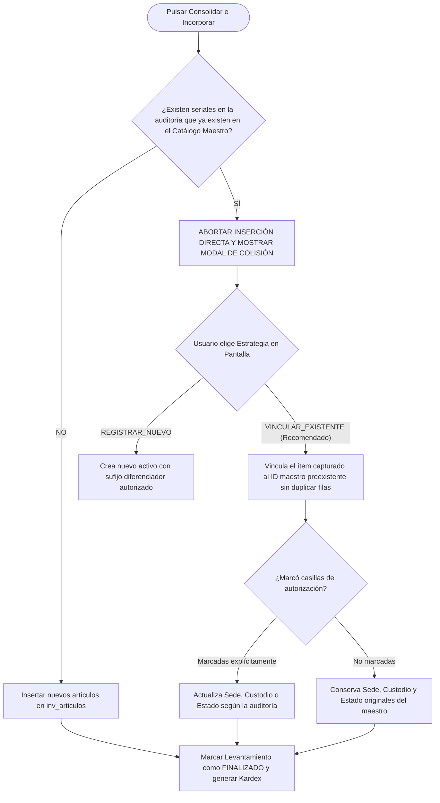

# MANUAL COMPLETO DE USUARIO Y GUÍA DE OPERACIÓN
# INGMELEC ALMACÉN ENTERPRISE

**Versión:** 2.0.0 Enterprise
**Fecha de Edición:** 3 de Noviembre de 2026
**Autor:** Coordinador Principal — Sistema Multiagente Enterprise
**Destinatarios:** Administradores, Supervisores, Encargados de Almacén, Auditores y Gerencia
**Entorno Operativo:** Producción / Clever Cloud MySQL / Servidor Express Local o Cloud

---

## ÍNDICE GENERAL

1. [Introducción y Objetivos](#1-introducción-y-objetivos)
2. [Arquitectura y Mapa de Navegación](#2-arquitectura-y-mapa-de-navegación)
3. [Acceso al Sistema y Gestión de Sesión](#3-acceso-al-sistema-y-gestión-de-sesión)
4. [Dashboard Principal y Analítica](#4-dashboard-principal-y-analítica)
5. [Inventario Maestro y Catálogo General](#5-inventario-maestro-y-catálogo-general)
6. [Gestión de Sedes, Campamentos y Almacenes](#6-gestión-de-sedes-campamentos-y-almacenes)
7. [Módulo de Levantamientos Físicos y Auditorías de Campo](#7-módulo-de-levantamientos-físicos-y-auditorías-de-campo)
8. [Importación Masiva de Datos desde Excel](#8-importación-masiva-de-datos-desde-excel)
9. [Movimientos de Inventario y Control de Salidas (Kardex)](#9-movimientos-de-inventario-y-control-de-salidas-kardex)
10. [Consolidación y Resolución de Duplicados](#10-consolidación-y-resolución-de-duplicados)
11. [Centro de Reportes y Exportación](#11-centro-de-reportes-y-exportación)
12. [Matriz de Usuarios, Roles y Permisos (RBAC)](#12-matriz-de-usuarios-roles-y-permisos-rbac)
13. [Seguridad, Auditoría y Protección de Datos](#13-seguridad-auditoría-y-protección-de-datos)
14. [Funcionalidades Ocultas, Atajos y Trucos Operativos](#14-funcionalidades-ocultas-atajos-y-trucos-operativos)
15. [Guía de Trabajo Diario: Escenarios Prácticos Paso a Paso](#15-guía-de-trabajo-diario-escenarios-prácticos-paso-a-paso)
16. [Matriz de Madurez de Funcionalidades y Límites Actuales](#16-matriz-de-madurez-de-funcionalidades-y-límites-actuales)

---

## 1. INTRODUCCIÓN Y OBJETIVOS

**INGMELEC ALMACÉN ENTERPRISE** es la plataforma corporativa de gestión logística, control de inventario maestro y auditorías físicas de campo desarrollada específicamente para las operaciones de infraestructura y electrificación de **INGMELEC DOMINICANA**.

### Propósito del Sistema:
* **Custodiar el Catálogo Maestro:** Mantener un inventario fidedigno de los bienes de la empresa clasificados por áreas operativas: **Informática**, **Oficinas**, **Cocina/Comedor** y **Almacén Central/Herramientas**.
* **Auditorías de Campo sin Papel:** Permitir a los equipos de auditoría y almacén desplazarse a campamentos de obra con laptops o tablets para realizar levantamientos físicos, capturar seriales con teclado rápido, importar planillas Excel y conciliar existencias sin alterar la base de datos a ciegas.
* **Trazabilidad Total (Kardex):** Registrar cada transferencia, entrega a brigada, devolución o ajuste mediante transacciones protegidas que impiden saldos negativos y garantizan la inmutabilidad de la bitácora.
* **Integridad Cero Duplicados:** Proteger el catálogo maestro contra inserciones dobles de un mismo serial o activo mediante algoritmos de vinculación inteligente (`VINCULAR_EXISTENTE`).

---

## 2. ARQUITECTURA Y MAPA DE NAVEGACIÓN

El sistema opera como una aplicación web de una sola página (SPA) responsiva con navegación fluida, sincronización de filtros en la URL del navegador y diseño corporativo en tonos pizarra y naranja industrial (`#F28524`).

### Estructura de la Interfaz:
```text
┌────────────────────────────────────────────────────────────────────────┐
│  BARRA SUPERIOR (Topbar.jsx)                                           │
│  [Logo INGMELEC]  [Indicador DB: Conectado]   [Rol Badge]  [Perfil]    │
├──────────────┬─────────────────────────────────────────────────────────┤
│ MENÚ LATERAL │ ÁREA PRINCIPAL DE TRABAJO (Workspace Canvas)            │
│ (Sidebar.jsx)│                                                         │
│              │ Contenido dinámico según el módulo seleccionado:        │
│ PRINCIPAL    │ - Métricas y gráficos analíticos                        │
│ • Dashboard  │ - Tablas de datos paginadas con búsqueda reactiva       │
│ CATÁLOGO     │ - Modales de detalle, edición y confirmación transacc.  │
│ • Maestro    │ - Entorno de captura rápida para teclado de laptop      │
│ • Informát.  │                                                         │
│ • Oficinas   │                                                         │
│ • Cocina     │                                                         │
│ • Almacén    │                                                         │
│ OPERACIONES  │                                                         │
│ • Levantami. │                                                         │
│ • Sedes/Camp.│                                                         │
│ • Movimiento │                                                         │
│ GESTIÓN      │                                                         │
│ • Reportes   │                                                         │
│ • Auditoría  │                                                         │
│ SISTEMA      │                                                         │
│ • Usuarios   │                                                         │
│ [Cerrar Ses.]│                                                         │
└──────────────┴─────────────────────────────────────────────────────────┘
```

### Mapa de Rutas y Páginas Disponibles:

| Identificador | Ruta URL | Módulo | Archivo Fuente Frontend |
|---|---|---|---|
| `dashboard` | `/dashboard` | Dashboard Analítico General | `src/pages/DashboardPage.jsx` |
| `inventario` | `/inventario` | Catálogo Maestro General (414 ítems) | `src/pages/InventarioGeneralPage.jsx` |
| `informatica` | `/informatica` | Subcatálogo Informática y Telecom | `src/pages/InformaticaPage.jsx` |
| `oficinas` | `/oficinas` | Subcatálogo Oficinas y Mobiliario | `src/pages/OficinasPage.jsx` |
| `cocina` | `/cocina` | Subcatálogo Cocina y Campamento | `src/pages/CocinaPage.jsx` |
| `almacen` | `/almacen` | Subcatálogo Almacén y Herramientas | `src/pages/AlmacenPage.jsx` |
| `levantamientos` | `/levantamientos` | Levantamientos Físicos y Workspace | `src/pages/LevantamientosPage.jsx` |
| `ubicaciones` | `/ubicaciones` | Sedes, Campamentos y Depósitos | `src/pages/UbicacionesPage.jsx` |
| `movimientos` | `/movimientos` | Movimientos de Stock y Kardex | `src/pages/MovimientosPage.jsx` |
| `reportes` | `/reportes` | Centro de Reportes y Exportación | `src/pages/ReportesPage.jsx` |
| `auditoria` | `/auditoria` | Bitácora Inmutable de Auditoría | `src/pages/AuditoriaPage.jsx` |
| `usuarios` | `/usuarios` | Administración de Usuarios y Roles | `src/pages/UsuariosPage.jsx` |

---

## 3. ACCESO AL SISTEMA Y GESTIÓN DE SESIÓN

### 3.1. Pantalla de Inicio de Sesión (`LoginPage.jsx`)
* **Acceso:** Se presenta automáticamente si el usuario no tiene una sesión activa en el navegador.
* **Campos Requeridos:**
  1. **Correo Electrónico Corporativo:** Debe coincidir con una cuenta activa en `inv_usuarios`.
  2. **Contraseña:** Clave de acceso con botón interactivo de ojo para visualizar u ocultar caracteres.
* **Mecanismos de Seguridad Activos:**
  * **Protección contra Fuerza Bruta:** El servidor limita las solicitudes a un máximo de **15 intentos por minuto por dirección IP**. Al superar este límite, el sistema bloquea los intentos retornando `HTTP 429 Too Many Requests` durante 60 segundos.
  * **Token Criptográfico JWT:** Tras la autenticación exitosa, el servidor emite un token JWT firmado criptográficamente con validez de **8 horas**.
  * **Persistencia Segura:** El token se almacena en el `localStorage` del navegador bajo la clave `ingmelec_token`.

### 3.2. Cuentas Corporativas Configuradas de Fábrica:

| Perfil / Cargo | Correo Electrónico | Contraseña Predeterminada | Rol de Seguridad |
|---|---|---|---|
| **Director de Operaciones** | `admin@ingmelec.com` | `admin.ingmelec.2026` | `admin` (Control total) |
| **Jefe de Almacén Central** | `almacen@ingmelec.com` | `almacen.2026` | `almacen` (Operativo completo) |
| **Supervisor de Infraestructura** | `supervisor@ingmelec.com` | `supervisor.2026` | `supervisor` (Operativo completo) |
| **Auditor de Activos** | `auditor@ingmelec.com` | `auditor.2026` | `auditor` (Consulta y auditoría) |
| **Director Ejecutivo / Gerencia** | `gerencia@ingmelec.com` | `gerencia.2026` | `gerencia` (Consulta ejecutiva) |

### 3.3. Cierre de Sesión
El botón **Cerrar Sesión** (icono de puerta roja en la esquina inferior del Sidebar) elimina de inmediato el token JWT del almacenamiento local, limpia el contexto de React y redirige a la pantalla de login.

---

## 4. DASHBOARD PRINCIPAL Y ANALÍTICA

El Dashboard (`DashboardPage.jsx`) es el centro neurálgico de control ejecutivo e inventario. Los datos se calculan dinámicamente en tiempo real mediante el endpoint `GET /api/v2/dashboard/kpis`.

### 4.1. Tarjetas Superiores de Métricas (KPIs)
* **Total de Bienes Inventariados:** Muestra el número consolidado de registros maestros (actualmente **414 artículos**). Al hacer clic, navega directamente a la vista general de inventario.
* **Desglose por Áreas Operativas:**
  * **Informática y Telecom:** 84 activos (Laptops, switches, routers, servidores, monitores).
  * **Oficinas y Mobiliario:** 69 activos (Escritorios, sillas ergonómicas, archivadores, aires acondicionados).
  * **Cocina y Comedor:** 0 activos iniciales (Área habilitada para nuevos campamentos).
  * **Almacén y Herramientas:** 261 activos (Herramientas eléctricas, cizallas, prensas, pértigas, equipos de protección).
  * *Interacción:* Cada tarjeta cuenta con un botón interactivo que filtra de inmediato la vista del área correspondiente.

### 4.2. Gráficos Interactivos (Librería Recharts)
1. **Gráfico de Barras de Distribución por Área:** Compara visualmente la concentración de activos entre las cuatro áreas principales.
2. **Gráfico Circular (Donut) de Condición Física:**
   * **Bueno (Verde `#10B981`):** Bienes operativos al 100%.
   * **Regular (Ámbar `#F59E0B`):** Bienes con desgaste operativo menor.
   * **Dañado (Rojo `#EF4444`):** Equipos averiados que requieren reparación técnica.
   * **Fuera de Servicio (Rojo Oscuro `#991B1B`):** Bienes inservibles o propuestos para desincorporación.
   * **Pendiente de Verificación (Gris `#64748B`):** Artículos cuya condición física no fue constatada visualmente en el corte inicial.
   * *Acción al Clic:* Hacer clic en cualquier sección del gráfico circular abre el Catálogo General filtrado exactamente por ese estado físico (ejemplo: `/inventario?estado=DANADO`).

---

## 5. INVENTARIO MAESTRO Y CATÁLOGO GENERAL

El Catálogo Maestro (`InventarioGeneralPage.jsx` apoyado en el componente reusable `InventoryTable.jsx`) permite explorar, buscar, auditar y actualizar los 414 registros oficiales de la empresa.

### 5.1. Barra de Herramientas y Búsqueda en Vivo
* **Buscador Universal con Debounce:** Permite escribir cualquier término y tras 300 ms de pausa ejecuta la búsqueda contra MySQL sin saturar el servidor. Busca por:
  * Nombre o descripción del bien (ej. *"Taladro"*, *"MacBook"*, *"Escritorio"*).
  * Marca o fabricante (*"Bosch"*, *"Dell"*, *"DeWalt"*, *"3M"*).
  * Código original o placa de activo (*"INF-0012"*, *"ACT-2026"*).
  * Número de Serie o IMEI exacto.
* **Filtros Multifactoriales Combinables:**
  * **Área:** TODAS, INFORMATICA, OFICINAS, COCINA, ALMACEN.
  * **Estado Físico:** TODOS, Bueno, Regular, Dañado, Fuera de servicio, Pendiente.
  * **Ubicación / Sede:** TODAS o sedes específicas (ej. *Distrito Nacional 27 de Febrero*, *KM 19 Aut Duarte*).
  * **Filtro de Excepción "Sin Serial / IMEI":** Checkbox que aisla los artículos que carecen de identificador serial para facilitar tareas de regularización.
  * **Filtro "Cantidad Pendiente":** Checkbox para aislar ítems cuya cantidad física requiere re-conteo.
* **Botón "Limpiar Filtros" (RotateCcw):** Restaura todos los selectores a su estado predeterminado con un solo clic.
* **Selector de Paginación:** Permite alternar entre **25, 50, 100 o 500 filas** por pantalla.

### 5.2. Visualización y Columnas de la Tabla
1. **Código:** Identificador maestro único.
2. **Bien / Descripción:** Nombre descriptivo del activo.
3. **Área / Categoría:** Clasificación departamental.
4. **Marca / Modelo:** Especificación técnica del fabricante.
5. **Serie / IMEI:** Identificador alfanumérico único del activo.
6. **Cant. Física:** Existencia numérica registrada.
7. **Estado:** Etiqueta visual con color semafórico.
8. **Ubicación:** Sede física donde se encuentra el bien.
9. **Acciones:** Botón de ojo para inspeccionar la ficha completa.

### 5.3. Ficha Integral de Detalle del Artículo (`ItemDetailModal.jsx`)
Al hacer clic sobre cualquier fila o en el botón de inspección, se abre una ventana modal con tres pestañas especializadas:

```text
┌────────────────────────────────────────────────────────────────────────┐
│ [Modal Detalle] - Taladro Percutor Inalámbrico 20V (ID: 101)           │
├────────────────────────────────────────────────────────────────────────┤
│ [Pestaña: DETALLE DEL BIEN] [Pestaña: ORIGEN] [Pestaña: MOVIMIENTOS]  │
│                                                                        │
│ Código: HER-0042        Área: ALMACEN       Categoría: Herramientas    │
│ Marca: DeWalt           Modelo: DCD791B     Serie: SN-DW-9821          │
│ Cantidad: 1.00          Unidad: Unidad      Estado: Bueno              │
│ Propietario: INGMELEC   Custodio: Juan P.   Ubicación: KM 19 AUT DUARTE│
│ Observaciones: Incluye estuche rígido y 2 baterías de 4Ah.             │
│                                                                        │
│ [Botón: Editar Artículo] [Botón: Registrar Movimiento] [Botón: Cerrar] │
└────────────────────────────────────────────────────────────────────────┘
```

* **Pestaña 1 (Detalle del Bien):** Especificaciones técnicas, custodio actual, estado operativo y notas. Permite conmutar a **Modo Edición** (para roles `admin`, `almacen`, `supervisor`) para corregir errores tipográficos o cambiar el custodio.
* **Pestaña 2 (Trazabilidad de Origen):** Muestra de qué hoja de Excel original provino el registro (`hoja_origen`), el número de fila exacto (`fila_origen`) y la fecha del corte físico.
* **Pestaña 3 (Historial de Movimientos / Kardex):** Muestra la línea de tiempo completa del activo: cuándo ingresó, quién lo trasladó, quién lo recibió y qué motivo justificó cada acción.

---

## 6. GESTIÓN DE SEDES, CAMPAMENTOS Y ALMACENES

El módulo de Sedes (`UbicacionesPage.jsx` y modales de `LevantamientosPage.jsx`) permite estructurar territorialmente los activos de INGMELEC.

### 6.1. Conceptos Clave:
* **Campamento / Sede:** Localidad geográfica o base de operaciones (ejemplo: *Campamento Azua*, *Base Central Santo Domingo*).
* **Almacén / Depósito:** Espacio físico específico dentro de un campamento (ejemplo: *Almacén Principal*, *Contenedor de Herramientas*, *Patio de Chatarra*).

### 6.2. Creación de un Nuevo Campamento:
1. Navegue a **Levantamientos y Auditorías** en el menú lateral.
2. Haga clic en el botón superior **"Gestionar Sedes y Almacenes"**.
3. En la sección "Registrar Nuevo Campamento", complete:
   * **Nombre del Campamento:** (ej. *"Campamento San Juan de la Maguana"*).
   * **Código de Sede:** Código alfanumérico corto (ej. *"CAMP-SJM-01"*).
   * **Provincia y Dirección:** Ubicación geográfica.
   * **Responsable y Teléfono:** Ingeniero o encargado de la base.
   * **Almacén Inicial:** Nombre del almacén creado por defecto (ej. *"Almacén Central"*).
4. Haga clic en **"Guardar Campamento"**. Se persiste de inmediato en `inv_campamentos` y crea su primer almacén en `inv_almacenes`.

### 6.3. Creación de Almacenes Adicionales:
Dentro del mismo modal, en la sección inferior "Añadir Almacén a Campamento Existente":
1. Seleccione el Campamento en el menú desplegable.
2. Indique el nombre del almacén (ej. *"Depósito de Equipos Averiados"*).
3. Seleccione el **Tipo de Almacén**:
   * *Principal:* Almacén general de suministros.
   * *Herramientas:* Pañol de herramientas para brigadas.
   * *Transitorio:* Zona de tránsito o despacho rápido.
   * *Chatarra / Baja:* Equipos pendientes de baja o descarte.
   * *Otro:* Áreas especiales.
4. Ingrese el Encargado y la Descripción.
5. Haga clic en **"Crear Almacén"**.

---

## 7. MÓDULO DE LEVANTAMIENTOS FÍSICOS Y AUDITORÍAS DE CAMPO

Este es el módulo operativo más potente del sistema, diseñado para realizar inventarios físicos completos en campo, ya sea de forma manual o mediante importación de archivos.

### 7.1. Flujo de Vida de un Levantamiento Físico:


### 7.2. Crear una Sesión de Levantamiento:
1. En **Levantamientos y Auditorías**, pulse el botón naranja **"Nuevo Levantamiento"**.
2. Complete el formulario modal:
   * **Título del Levantamiento:** Nombre descriptivo (ej. *"Auditoría General Campamento San Cristóbal Q4"*).
   * **Campamento y Almacén:** Seleccione la sede y el depósito objeto de inspección.
   * **Fecha de Inicio:** Fecha del operativo.
   * **Responsable del Levantamiento:** Auditor o almacenista líder.
   * **Equipo Auditor:** Nombres de los técnicos acompañantes.
   * **Notas:** Justificación u objetivo de la auditoría.
3. Pulse **"Iniciar Levantamiento"**. El sistema crea la cabecera en `inv_levantamientos` con estado `En preparación` y código secuencial único (ej. `LEV-2026-003`).

### 7.3. El Espacio de Trabajo de Campo (`LevantamientoWorkspace.jsx`)
Al hacer clic en **"Entrar a Captura"** en la tarjeta de cualquier levantamiento, la interfaz se transforma en una consola especializada de alto rendimiento:

```text
┌────────────────────────────────────────────────────────────────────────┐
│ LEV-2026-001 · Auditoría Almacén San Cristóbal        [Estado: En Proc]│
│ [Volver] [Cambiar Estado] [Importar Excel] [Consolidar e Incorporar]   │
├──────────────────────────────────┬─────────────────────────────────────┤
│ FORMULARIO DE CAPTURA RÁPIDA     │ RESUMEN DE SESIÓN Y LISTA CAPTURADA │
│                                  │                                     │
│ [Autocompletar Catálogo Maestro] │ ┌───┐ ┌───┐ ┌───┐ ┌───┐             │
│ [Escriba para buscar activo...]  │ │ 8 │ │ 6 │ │ 2 │ │ 0 │             │
│                                  │ Total Bueno Regul Daño              │
│ Área: [ALMACEN      ▼] Código: [ ] │                                     │
│ Descripción: [                   ] │ [Todas] [Almacén] [Informática]     │
│ Marca: [       ] Modelo: [       ] │ [Buscar en capturados...        ] │
│ Serie/IMEI: [                    ] │                                     │
│ Cantidad: [ 1 ] Unidad: [Unidad ▼] │ Tabla de Ítems en Sesión:           │
│ Estado: [Bueno (Operativo)     ▼] │ • Taladro Bosch SN-9812 [Editar][x] │
│ Custodio: [        ] Ubic: [     ] │ • Laptop Dell SN-7721   [Editar][x] │
│ [x] Mantener Custodio y Ubicación │ • Pinza Fluke SN-0043   [Editar][x] │
│                                  │                                     │
│ [Guardar y Otro (Ctrl+Enter)]    │                                     │
│ [Guardar y Terminar]             │                                     │
└──────────────────────────────────┴─────────────────────────────────────┘
```

### 7.4. Características del Formulario de Captura:
1. **Autocompletado Maestro:** Permite buscar artículos del catálogo general. Al seleccionar uno, precarga automáticamente la descripción, marca, modelo, categoría y unidad de medida, ahorrando tiempo de tipeo.
2. **Detección Reactiva de Duplicados en Sesión:** Si el auditor ingresa un número de serie o IMEI que ya fue registrado previamente en la misma auditoría, aparece de inmediato un **banner ámbar de advertencia**:
   *`¡Atención! La serie/IMEI "SN-1234" ya fue registrada en este levantamiento para "Taladro Bosch".`*
   Esto previene que dos auditores en esquinas distintas del almacén cuenten el mismo equipo por error.
3. **Campos Adherentes (*Sticky Fields*):** Al marcar la casilla *"Mantener Área, Custodio y Ubicación para el siguiente artículo"*, el sistema preserva estos valores tras cada guardado, permitiendo ingresar decenas de herramientas asignadas a una misma brigada sin tener que reescribir sus datos.
4. **Atajo de Teclado `Ctrl + Enter`:** Presionar esta combinación guarda el artículo en la base de datos de inmediato y devuelve el foco al campo "Descripción" para continuar la digitación sin tocar el mouse.

### 7.5. Guardar Avances y Reanudar Otro Día:
El sistema es **100% transaccional y persistente**. Cada artículo guardado queda almacenado en la tabla `inv_levantamiento_items`. El usuario puede cerrar el navegador, apagar la laptop o desconectarse. Al ingresar nuevamente y hacer clic en "Entrar a Captura", todo el avance permanece intacto.

---

## 8. IMPORTACIÓN MASIVA DE DATOS DESDE EXCEL

Cuando se dispone de inventarios previos en planillas electrónicas, el módulo de levantamiento permite cargarlos de forma instantánea sin instalaciones complejas.

### 8.1. Especificaciones Técnicas del Archivo:
* **Formatos Admitidos:** Archivos de Microsoft Excel (`.xlsx`, `.xls`) o valores separados por comas (`.csv`).
* **Límite de Seguridad:** **Hasta 5,000 registros por lote de importación**. Este límite evita la degradación de memoria del servidor. Si un inventario supera esta cifra, debe cargarse dividido en pestañas o lotes independientes.

### 8.2. Mapeo Inteligente de Columnas:
El motor de importación en cliente reconoce encabezados sin importar mayúsculas, minúsculas o acentos, basándose en el siguiente diccionario de sinónimos:

| Campo del Sistema | Encabezados Válidos en Excel | Obligatorio | Valor Predeterminado si está Vacío |
|---|---|:---:|---|
| **Descripción / Bien** | `articulo`, `artículo`, `descripcion`, `descripción`, `nombre`, `equipo`, `bien` | **SÍ** | La fila se omite si falta este campo |
| **Código Original** | `codigo`, `código`, `cod`, `id`, `placa` | No | Vacío |
| **Marca** | `marca`, `fabricante`, `brand` | No | `S/M` (Sin Marca) |
| **Modelo** | `modelo`, `caracteristicas`, `especificaciones`, `model` | No | Vacío |
| **Serie / IMEI** | `serie`, `serial`, `imei`, `sn` | No | `S/S` (Sin Serie) |
| **Cantidad** | `cantidad`, `cant`, `qty`, `existencia` | No | `1` |
| **Estado Físico** | `estado`, `condicion`, `condición`, `status` | No | `Bueno` |
| **Custodio / Responsable** | `responsable`, `custodio`, `asignado`, `tecnico`, `brigada` | No | Vacío |
| **Ubicación Exacta** | `ubicacion`, `ubicación`, `lugar`, `deposito`, `estante`, `rack` | No | Vacío |
| **Observaciones** | `observacion`, `observaciones`, `nota`, `comentarios` | No | Vacío |

### 8.3. Procedimiento de Carga Paso a Paso:
1. Dentro del Workspace del levantamiento, pulse el botón **"Importar Excel"**.
2. Arrastre el archivo `.xlsx` al recuadro o selecciónelo desde el explorador.
3. El sistema lee el libro en milisegundos y muestra un **selector de hojas**. Si el archivo contiene varias pestañas (ejemplo: *Informática*, *Almacén*, *Oficinas*), seleccione la hoja deseada.
4. Se desplegará la **Tabla de Previsualización**, indicando cuántos artículos válidos fueron identificados y permitiendo verificar las columnas mapeadas.
5. Pulse **"Confirmar e Importar Lote"**.
6. Los registros se insertan en bloque en `inv_levantamiento_items` y quedan asociados al levantamiento activo.

### 8.4. Plantilla de Ejemplo:
El sistema contiene una planilla maestra de referencia en el repositorio:
[`server/data/Ingmelec_Levantamiento_Sencillo_2026-10-16.xlsx`](file:///c:/Users/gener/OneDrive/Desktop/ALMACEN%20INGMELEC/INGMELEC-DOMINICANA-main/INGMELEC-DOMINICANA-main/server/data/Ingmelec_Levantamiento_Sencillo_2026-10-16.xlsx).

---

## 9. MOVIMIENTOS DE INVENTARIO Y CONTROL DE SALIDAS (KARDEX)

El módulo de Movimientos (`MovimientosPage.jsx`) gestiona el flujo operativo diario del almacén y garantiza la trazabilidad física de los bienes.

### 9.1. Tipos de Movimiento Autorizados:
1. **ENTRADA (Badge Verde):** Ingreso de nuevas compras, herramientas adquiridas o materiales recibidos de proveedores. **Incrementa el stock físico** del artículo.
2. **SALIDA (Badge Rojo):** Despacho de materiales, consumo o bajas operativas. **Disminuye el stock físico**.
3. **TRASLADO (Badge Azul):** Movilización de herramientas o equipos entre campamentos (ej. de *Distrito Nacional* a *KM 19 Aut Duarte*). Mantiene la cantidad global y actualiza la sede del bien.
4. **ASIGNACIÓN (Badge Índigo):** Entrega formal de una herramienta o equipo de protección a un técnico o brigada. Actualiza el campo `asignado_a / custodio`.
5. **DEVOLUCION (Badge Púrpura):** Reingreso al almacén de un bien que estaba asignado a un colaborador.
6. **AJUSTE (Badge Ámbar):** Corrección justificada de inventario por rotura, merma o hallazgo tras conteo.

### 9.2. Regla Inquebrantable de Existencias (Protección contra Saldo Negativo):
El backend ejecuta cada movimiento dentro de una transacción con bloqueo pesimista `SELECT ... FOR UPDATE` sobre la tabla `inv_articulos`.
* Si un usuario intenta registrar una **SALIDA de 5 unidades** de un bien que solo tiene **3 disponibles**, la base de datos **aborta la transacción de inmediato** y muestra un mensaje de error explícito:
  *`❌ Stock insuficiente. Cantidad disponible: 3. No se permiten saldos negativos.`*
* Esta regla garantiza matemáticamente que ninguna sede o almacén presente existencias negativas.

### 9.3. Formulario de Registro de Movimiento:
* **Artículo:** Selector con autocompletado del bien a mover.
* **Tipo de Movimiento:** Entrada, Salida, Traslado, Asignación, Devolución o Ajuste.
* **Cantidad:** Valor numérico estrictamente mayor a cero.
* **Ubicación Destino:** Nueva sede física (si aplica).
* **Custodio Destino:** Nuevo responsable técnico (si aplica).
* **Estado Nuevo:** Condición física resultante tras el movimiento (Bueno, Regular, Dañado).
* **Motivo de Movimiento (Obligatorio):** Justificación operacional (ej. *"Requerimiento Brigada 04 para mantenimiento en Azua"*).
* **Observaciones:** Notas complementarias.

---

## 10. CONSOLIDACIÓN Y RESOLUCIÓN DE DUPLICADOS

La consolidación es el proceso formal mediante el cual los artículos capturados durante un levantamiento físico pasan a formar parte del **Inventario Maestro Oficial** de INGMELEC.

### 10.1. ¿Por qué es un proceso crítico?
Antes de la Fase 2, consolidar una auditoría insertaba ciegamente todos los ítems en la tabla maestra. Si en un campamento se capturaba un generador con el serial `SN-GEN-5544` que ya existía en el inventario, el sistema insertaba un segundo activo idéntico, duplicando artificialmente el valor y las existencias de la empresa.

### 10.2. El Algoritmo Anticolisión y la Estrategia `VINCULAR_EXISTENTE`:
Cuando el usuario pulsa **"Consolidar e Incorporar"**, el sistema evalúa cada artículo del levantamiento contra los 414 registros maestros existentes:



### 10.3. Casillas de Autorización Explícita:
Para salvaguardar la información maestra, el sistema **no asume cambios automáticos**. El usuario debe marcar conscientemente:
* `[ ] Autorizar actualización de Sede/Ubicación:` Actualiza la ubicación física del bien en el maestro con la encontrada en el campamento.
* `[ ] Autorizar actualización de Custodio/Responsable:` Transfiere formalmente la responsabilidad al custodio registrado en campo.
* `[ ] Autorizar actualización de Estado Físico:` Actualiza la condición (ej. si el bien pasó de "Bueno" a "Dañado").

### 10.4. Inmutabilidad tras la Consolidación:
Una vez que el levantamiento se consolida exitosamente:
1. El estado cambia irreversiblemente a **`Finalizado`**.
2. Se registra quién consolidó y la marca de tiempo exacta.
3. Se bloquean los botones de agregar, editar o eliminar ítems. Cualquier intento de enviar peticiones manuales a la API resulta en `HTTP 409 Conflict: El levantamiento está finalizado y no puede ser modificado`.

---

## 11. CENTRO DE REPORTES Y EXPORTACIÓN

El Centro de Reportes (`ReportesPage.jsx`) consolida la información gerencial de inventario y provee salidas estructuradas de datos.

### 11.1. Reporte Consolidado en Pantalla:
Presenta tablas agregadas de:
* Distribución de bienes y cantidades por área operativa.
* Balance de condición operativa (% de bienes en estado Bueno vs Dañado).
* Resumen de activos por sede física.

### 11.2. Opciones de Salida Verificadas en Código:
1. **Exportar CSV Completo (`handleExportFullCsv`):**
   * Descarga un archivo con formato `.csv` codificado en **UTF-8 con BOM** (`\uFEFF`), lo que asegura que caracteres especiales, acentos, eñes y comas se abran perfectamente en Microsoft Excel en Windows.
   * Contiene **17 columnas maestras**: ID, Código, Área, Categoría, Artículo, Marca/Modelo, Serie/IMEI, Cantidad, Unidad, Estado, Ubicación, Zona/Estante, Propietario, Custodio, Observaciones, Hoja Origen y Fila Origen.
   * Nombre automático del archivo: `reporte_maestro_ingmelec_YYYY-MM-DD.csv`.
2. **Imprimir / Guardar como PDF (`handlePrint`):**
   * Invoca la función nativa del navegador `window.print()`.
   * Permite imprimir en papel o seleccionar **"Guardar como PDF"** en el diálogo del sistema operativo con formato de página optimizado.
   * *Aclaración técnica:* No existe una librería de renderizado PDF directo en backend (como PDFKit); la salida a PDF se realiza a través del diálogo de impresión del navegador.

---

## 12. MATRIZ DE USUARIOS, ROLES Y PERMISOS (RBAC)

El control de acceso por roles restringe cada acción en la interfaz y en el servidor:

| Funcionalidad / Módulo | `admin` (Director) | `almacen` (Encargado) | `supervisor` (Operativo) | `auditor` (Control) | `gerencia` (Dirección) |
|---|:---:|:---:|:---:|:---:|:---:|
| **Ver Dashboard y Gráficos** | ✅ Total | ✅ Total | ✅ Total | ✅ Total | ✅ Total |
| **Consultar Catálogo Maestro** | ✅ Total | ✅ Total | ✅ Total | ✅ Total | ✅ Total |
| **Crear / Editar Artículos Maestros** | ✅ Permitido | ✅ Permitido | ✅ Permitido | ❌ Denegado | ❌ Denegado |
| **Eliminar Artículos Maestros** | ✅ Exclusivo | ❌ Denegado | ❌ Denegado | ❌ Denegado | ❌ Denegado |
| **Crear Levantamientos Físicos** | ✅ Permitido | ✅ Permitido | ✅ Permitido | ✅ Permitido | ❌ Denegado |
| **Capturar Ítems en Levantamiento** | ✅ Permitido | ✅ Permitido | ✅ Permitido | ✅ Permitido | ❌ Denegado |
| **Importar Excel en Levantamiento** | ✅ Permitido | ✅ Permitido | ✅ Permitido | ❌ Denegado | ❌ Denegado |
| **Consolidar Levantamientos** | ✅ Permitido | ✅ Permitido | ✅ Permitido | ❌ Denegado | ❌ Denegado |
| **Registrar Movimientos (Kardex)** | ✅ Permitido | ✅ Permitido | ✅ Permitido | ❌ Denegado | ❌ Denegado |
| **Exportar CSV y Reportes** | ✅ Permitido | ✅ Permitido | ✅ Permitido | ✅ Permitido | ✅ Permitido |
| **Ver Bitácora de Auditoría** | ✅ Permitido | ❌ Denegado | ❌ Denegado | ✅ Permitido | ✅ Permitido |
| **Crear y Administrar Usuarios** | ✅ Exclusivo | ❌ Denegado | ❌ Denegado | ❌ Denegado | ❌ Denegado |
| **Crear Sedes y Almacenes** | ✅ Permitido | ✅ Permitido | ✅ Permitido | ❌ Denegado | ❌ Denegado |

*Nota sobre permisos por sede:* En la versión actual los permisos aplican de forma global a nivel de rol. La restricción para que un almacenista solo visualice u opere en un campamento específico está documentada como una mejora para la Fase 5.

---

## 13. SEGURIDAD, AUDITORÍA Y PROTECCIÓN DE DATOS

### 13.1. Protección Criptográfica de Contraseñas:
* Las credenciales no se almacenan jamás en texto plano.
* Cada contraseña es procesada mediante el algoritmo estándar **PBKDF2 con salting criptográfico aleatorio de 16 bytes y hash SHA-512** a 1,000 iteraciones (implementado en `initDb.js` y `import-excel.js`).

### 13.2. Bitácora de Auditoría Inmutable (`inv_auditoria`):
Cada operación crítica genera un registro histórico con:
* Fecha y hora exacta del servidor.
* ID y nombre del usuario ejecutante.
* Acción (ej. `LOGIN_EXITOSO`, `CREAR_ARTICULO`, `CONSOLIDAR_LEVANTAMIENTO`).
* Tabla y registro afectado.
* Dirección IP de origen.
* Registro del estado anterior y estado nuevo en formato JSON.

### 13.3. Guardián de Base de Datos (`server/database/guard.js`):
El backend incorpora un guardián de seguridad que inspecciona la variable `DB_HOST`. Si detecta que apunta a Clever Cloud o a cualquier host remoto, **aborta automáticamente cualquier script que intente ejecutar comandos destructivos** (`TRUNCATE`, `DROP TABLE`, `ALTER`), protegiendo los 414 registros maestros contra ejecuciones accidentales.

---

## 14. FUNCIONALIDADES OCULTAS, ATAJOS Y TRUCOS OPERATIVOS

1. **Atajo `Ctrl + Enter` en Levantamientos:**
   * Al estar digitando en el formulario de captura, presione `Ctrl + Enter` (o `Cmd + Enter` en Mac) para guardar el artículo y limpiar el formulario al instante, manteniendo el foco en el campo "Descripción".
2. **Campos Adherentes (*Sticky Fields*):**
   * En auditorías donde se registran 20 herramientas de una misma brigada, marque la casilla de retención. Solo tendrá que escribir la descripción y el serial; el custodio y la ubicación permanecerán fijos.
3. **Búsqueda con Memoria en la URL:**
   * Al filtrar el inventario (ej. por estado "Dañado" o área "Informática"), la URL se actualiza a `/inventario?estado=DANADO&area=INFORMATICA`. Puede copiar ese enlace y enviarlo a otro usuario autenticado para que abra exactamente la misma vista filtrada.
4. **Colapso Rápido del Menú:**
   * Pulse el botón de flecha junto al logotipo para contraer el menú lateral a modo de iconos, ganando más de 180 píxeles de ancho en pantallas de laptop pequeñas (13 y 14 pulgadas).
5. **Navegación Cruzada desde Gráficos:**
   * Los gráficos del Dashboard no son estáticos; hacer clic en cualquier barra o segmento de pastel filtra y abre la tabla de inventario correspondiente.
6. **Sufijos de Advertencia en Importación:**
   * Si una fila de Excel no tiene cantidad, el sistema le asigna `1`. Si no tiene marca, le asigna `S/M`. Esto evita que la fila sea descartada por el parser.

---

## 15. GUÍA DE TRABAJO DIARIO: ESCENARIOS PRÁCTICOS PASO A PASO

A continuación se presentan los 7 procedimientos estándar para la operación cotidiana:

---

### ESCENARIO A: Registrar un Artículo Nuevo en el Catálogo Maestro

* **Perfil Requerido:** `admin`, `almacen` o `supervisor`.
* **Paso 1:** En el menú lateral, haga clic en **"Inventario Maestro"**.
* **Paso 2:** En la esquina superior derecha, pulse el botón naranja **"Nuevo Artículo"**.
* **Paso 3:** Se abrirá el modal de registro. Complete los campos:
  * *Descripción del Bien (Obligatorio):* ej. *"Rotomartillo SDS-Plus 1 pulgada 800W"*.
  * *Área:* Seleccione `ALMACEN`.
  * *Categoría:* ej. *"Herramientas Eléctricas"*.
  * *Marca y Modelo:* ej. *"Bosch"* / *"GBH 2-26 DRE"*.
  * *Serie / IMEI:* ej. *"SN-BOSCH-88219"*.
  * *Cantidad:* `1`.
  * *Unidad de Medida:* `Unidad`.
  * *Estado Físico:* `Bueno`.
  * *Ubicación:* Seleccione *"KM 19 AUT DUARTE"*.
  * *Custodio:* ej. *"Almacén Central"*.
* **Paso 4:** Pulse **"Guardar en Inventario Maestro"**.
* **Resultado:** El activo se inserta en `inv_articulos`, el contador general sube a 415 y se genera un registro en la bitácora de auditoría.

---

### ESCENARIO B: Crear un Campamento Nuevo y Registrar su Almacén

* **Perfil Requerido:** `admin`, `almacen` o `supervisor`.
* **Paso 1:** Ingrese a **"Levantamientos y Auditorías"**.
* **Paso 2:** Pulse el botón **"Gestionar Sedes y Almacenes"**.
* **Paso 3:** En el formulario "Registrar Nuevo Campamento", digite:
  * *Nombre:* *"Campamento Monte Plata - Subestación 04"*.
  * *Código:* *"CAMP-MP-04"*.
  * *Provincia:* *"Monte Plata"*.
  * *Dirección:* *"Carretera Sabana Grande km 5"*.
  * *Responsable:* *"Ing. Manuel Terrero"*.
  * *Almacén Inicial:* *"Almacén General de Obra"*.
* **Paso 4:** Pulse **"Guardar Campamento"**.
* **Paso 5:** Para añadir un segundo depósito (ejemplo un contenedor de herramientas), baje a "Añadir Almacén", seleccione el campamento recién creado, escriba *"Contenedor de Herramientas de Brigada"* con tipo `Herramientas` y pulse **"Crear Almacén"**.
* **Resultado:** El campamento y sus depósitos quedan disponibles de inmediato para asignar artículos y abrir auditorías.

---

### ESCENARIO C: Realizar un Levantamiento Físico desde una Laptop en Campo

* **Perfil Requerido:** `admin`, `almacen`, `supervisor` o `auditor`.
* **Paso 1:** Vaya a **"Levantamientos y Auditorías"** y pulse **"Nuevo Levantamiento"**.
* **Paso 2:** Ingrese el título: *"Auditoría Inicial Campamento Monte Plata"*, seleccione el Campamento y Almacén creados en el Escenario B, y pulse **"Iniciar Levantamiento"**.
* **Paso 3:** En la tarjeta creada, haga clic en el botón negro **"Entrar a Captura"**.
* **Paso 4 (Captura con Teclado):**
  * Escriba en Descripción: *"Cizalla de 36 pulgadas"*.
  * Marca: *"DeWalt"*.
  * Serie: *"SN-MP-001"*.
  * Estado: *"Bueno"*.
  * Marque la casilla: `[x] Mantener Custodio y Ubicación`.
  * Presione **`Ctrl + Enter`**. El ítem se guarda y aparece en la tabla de la derecha.
* **Paso 5:** El foco vuelve automáticamente a la Descripción. Escriba *"Pértiga telescópica 15kV"*, serie *"SN-MP-002"*, presione **`Ctrl + Enter`**.
* **Paso 6:** Si termina la jornada, pulse **"Guardar y Terminar"** y luego **"Volver a Sesiones"**.
* **Resultado:** Los ítems quedan guardados con seguridad en MySQL. Puede apagar el equipo y continuar al día siguiente.

---

### ESCENARIO D: Importar un Archivo Excel con Artículos de un Almacén

* **Perfil Requerido:** `admin`, `almacen` o `supervisor`.
* **Paso 1:** Entre al Workspace del levantamiento donde desea cargar los datos.
* **Paso 2:** En la barra superior de acciones, pulse **"Importar Excel"**.
* **Paso 3:** Seleccione el archivo `.xlsx` de su computadora.
* **Paso 4:** Si el libro tiene varias hojas, seleccione la hoja correspondiente.
* **Paso 5:** Revise la tabla de previsualización. Verifique que el conteo de artículos coincida con su planilla.
* **Paso 6:** Pulse **"Confirmar e Importar Lote"**.
* **Resultado:** Hasta 5,000 artículos se procesan e incorporan a la auditoría activa en pocos segundos.

---

### ESCENARIO E: Encontrar un Artículo cuyo Serial ya Existe en el Inventario Maestro

* **Perfil Requerido:** `admin`, `almacen` o `supervisor`.
* **Paso 1:** Durante una auditoría, se captura una herramienta con el serial `SN-REAL-BOSCH-01` (serial que ya pertenece a un activo maestro preexistente).
* **Paso 2:** Al finalizar el conteo físico, pulse **"Consolidar e Incorporar"**.
* **Paso 3:** Marque la casilla de confirmación y pulse **"Confirmar Consolidación"**.
* **Paso 4:** El sistema detecta la colisión e interrumpe la inserción directa, mostrando el modal:
  *`🚨 Aviso de Seriales Preexistentes: Se detectaron colisiones con artículos del inventario maestro.`*
* **Paso 5:** Seleccione la estrategia recomendada: **`VINCULAR_EXISTENTE`**.
* **Paso 6:** Si desea actualizar la ubicación del bien maestro con la encontrada en campo, marque `[x] Autorizar actualización de Sede`.
* **Paso 7:** Pulse **"Ejecutar Conciliación Segura"**.
* **Resultado:** El sistema vincula el artículo de la auditoría al registro maestro original sin crear un duplicado en `inv_articulos`, actualiza la sede autorizada y sella el levantamiento como `Finalizado`.

---

### ESCENARIO F: Registrar una Salida de Almacén y Consultar su Historial

* **Perfil Requerido:** `admin`, `almacen` o `supervisor`.
* **Paso 1:** En el menú lateral, haga clic en **"Movimientos de Stock"**.
* **Paso 2:** Pulse el botón superior **"Registrar Movimiento"**.
* **Paso 3:** Complete el formulario:
  * *Artículo:* Seleccione el activo a entregar (ej. *"Cizalla de 24 pulgadas"*).
  * *Tipo:* Seleccione **`SALIDA`** (o `ASIGNACION`).
  * *Cantidad:* `1`.
  * *Custodio Destino:* *"Brigada 03 - Juan Carlos Reyes"*.
  * *Motivo:* *"Entrega de herramienta para faena en línea de transmisión"*.
* **Paso 4:** Pulse **"Confirmar Movimiento"**.
* **Paso 5 (Verificación):** En la tabla de movimientos, la primera fila mostrará el movimiento con badge rojo `Salida` o azul `Asignación`. Además, al consultar el artículo en el inventario maestro, su stock habrá disminuido y en la pestaña "Kardex" constará el registro formal.

---

### ESCENARIO G: Consultar Existencias y Generar un Reporte Exportable

* **Perfil Requerido:** Cualquier rol (incluyendo `auditor` y `gerencia`).
* **Paso 1:** Ingrese a **"Centro de Reportes"**.
* **Paso 2:** Revise los gráficos consolidados y las tablas por área.
* **Paso 3 (Opción Excel):** Haga clic en el botón naranja **"Exportar CSV Completo"**. Su navegador descargará el archivo con las 17 columnas y 414 registros, listo para abrir en Microsoft Excel.
* **Paso 4 (Opción Impresión / PDF):** Haga clic en el botón **"Imprimir / PDF"**. Se abrirá el diálogo del sistema operativo; seleccione su impresora o la opción "Guardar como PDF".

---

## 16. MATRIZ DE MADUREZ DE FUNCIONALIDADES Y LÍMITES ACTUALES

Para garantizar total transparencia operativa, se resume el estado técnico real de cada capacidad de la plataforma:

| Capacidad del Sistema | Estado Actual | Archivo / Componente que lo Confirma | Observación Operativa |
|---|:---:|---|---|
| **Catálogo Maestro (414 ítems)** | **Operativo al 100%** | `InventarioTable.jsx`, `almacenApi.js` | Búsqueda, filtros y paginación plenamente funcionales. |
| **Workspace de Campo Laptop** | **Operativo al 100%** | `LevantamientoWorkspace.jsx` | Atajo `Ctrl+Enter`, sticky fields y detección en vivo. |
| **Importación Masiva Excel** | **Operativo al 100%** | `LevantamientoWorkspace.jsx` | Límite seguro de 5,000 filas por lote. |
| **Conciliación Antiduplicados** | **Operativo al 100%** | `almacenApi.js` (Ruta `/consolidar`) | Estrategia `VINCULAR_EXISTENTE` y flags de cambio. |
| **Kardex y Bloqueo No-Negativos** | **Operativo al 100%** | `almacenApi.js` (Ruta `/movimientos`) | Transacciones ACID con `FOR UPDATE`. |
| **Autenticación y Rate Limiting** | **Operativo al 100%** | `server/index.js`, `auth.js` | 15 intentos/min -> HTTP 429. JWT 8 horas. |
| **Exportación CSV (Excel)** | **Operativo al 100%** | `ReportesPage.jsx`, `InventoryTable.jsx` | Codificación UTF-8 con BOM. |
| **Impresión / Salida PDF** | **Operativo Vía Navegador** | `ReportesPage.jsx` (`window.print()`) | Depende del diálogo de impresión del sistema. |
| **Uso en Móviles Estrechos (<640px)** | **Operativo con Restricción** | Reportado en `VALIDACION_FINAL_FASE_4.md` | Barra sticky puede interceptar toques. Preferir laptop. |
| **Permisos Granulares por Campamento** | **Pendiente para Fase 5** | Planificado en arquitectura | Actualmente los roles aplican a nivel de toda la empresa. |
| **Generador PDF Server-Side Directo** | **No Disponible** | No implementado en backend | No existe endpoint directo generador de binarios `.pdf`. |

---
*Manual Completo de Usuario y Operación — INGMELEC ALMACÉN ENTERPRISE.*
