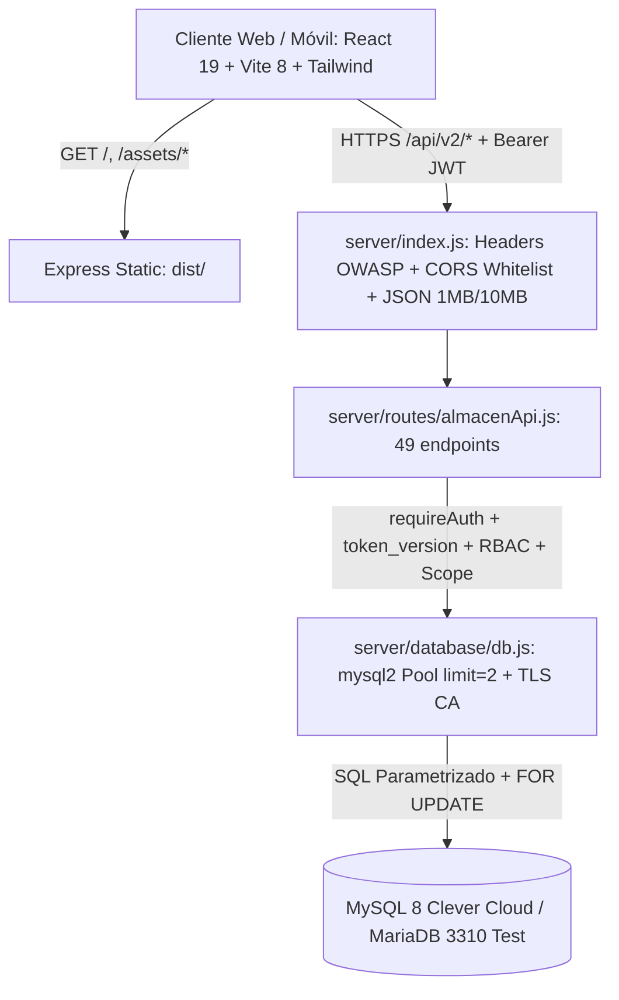

# INGMELEC | ALMACÉN GENERAL v2.1 — Contexto Técnico Completo para Claude

**Propósito de este documento:** Brindar a Claude una radiografía autónoma, exacta y verificada del sistema **INGMELEC | ALMACÉN GENERAL (v2.1)** para que pueda comprender el proyecto desde cero, evaluar su arquitectura, auditar decisiones técnicas y proponer mejoras sin requerir historial previo de conversación.

---

## 1. Contexto del Negocio

- **Empresa:** INGMELEC DOMINICANA (operaciones de ingeniería eléctrica, mantenimiento, oficinas y campamentos en República Dominicana).
- **Sistema:** Plataforma web corporativa de gestión de inventario físico, almacenes, movimientos de stock, levantamientos en campo, auditoría forense y control de acceso multi-sede.
- **Áreas operativas cubiertas:** `ALMACEN`, `INFORMATICA`, `COCINA`, `OFICINAS` (y soporte en esquema para `OTRA`).
- **Sedes canónicas actuales:**
  - `ALM-27FEB` (Almacén / Distrito Nacional 27 de Febrero)
  - `CAMP-OPL` (Campamento KM 19 Autopista Duarte OPL)
  - `CAMP-M633` (Mantenimiento 633)
- **Contexto histórico de datos:** El sistema administra inventario maestro real (`es_sintetico = 0`) proveniente originalmente de planillas Excel históricas (`origen_datos = 'HISTORICO_EXCEL'`) más altas operativas recientes (`'OPERATIVO_REAL'`). Existen registros históricos con ubicación ambigua (`KM 19 AUT DUARTE`, `estado_vinculacion_sede = 'SEDE_AMBIGUA'`) y registros históricos de OPL/M633 cuyos `campamento_id`/`almacen_id` originales fueron preservados explícitamente sin mutación destructiva.

---

## 2. Arquitectura Actual

- **Patrón:** Monolito modular desplegado como un solo servicio Node.js/Express (`server/index.js`) que sirve tanto el frontend compilado (`dist/`) como la API REST bajo `/api/v2`.
- **Comunicación:** El frontend no usa variables de entorno `VITE_*` para la API; consume rutas relativas `/api/v2/*` (en desarrollo Vite proxea `/api` hacia `http://localhost:5000`).

---

## 3. Funcionalidades Implementadas (y Alcance Real)

1. **Autenticación y Sesión (`/api/v2/auth/*`, `LoginPage.jsx`):** Login con Argon2id + auto-upgrade desde hashes legados; JWT HS256 con expiración (12h por defecto) y revocación inmediata vía `token_version`.
2. **Dashboard Ejecutivo (`DashboardPage.jsx`):** KPIs en tiempo real (`GET /api/v2/dashboard/kpis`), gráficos Recharts por área y estado físico, filtro global por sede/almacén (`activeCampamento`) y navegación drill-down hacia `/inventario`.
3. **Inventario Maestro y por Áreas (`InventoryTable.jsx`, `ItemDetailModal.jsx`, 5 páginas wrapper):** Listado con paginación en servidor (25–500), ordenamiento seguro, filtros combinados, creación con auto-código (`/articulos/next-code`), edición, baja lógica (`activo = 0`) y ficha técnica con pestañas Detalle / Origen Excel / Movimientos.
4. **Movimientos de Stock (`MovimientosPage.jsx`):** Kárdex inmutable (`ENTRADA`, `SALIDA`, `TRASLADO`, `ASIGNACION`, `DEVOLUCION`, `AJUSTE`) con transacciones y bloqueo `FOR UPDATE`.
5. **Campamentos, Almacenes y Alias (`UbicacionesPage.jsx`):** Gestión de sedes y bodegas, catálogo de alias (`inv_campamento_alias`), resolución heurística (`resolver-alias`) y motor de reasignación con simulación dry-run (`preview`) y ejecución atómica (`aplicar`).
6. **Levantamientos Físicos y Consolidación (`LevantamientosPage.jsx`, `LevantamientoWorkspace.jsx`):** Sesiones de conteo en campo, captura rápida con campos sticky, detección de duplicados, importación masiva Excel/CSV (máx. 5,000 filas, chunks de 500), conciliación físico vs teórico y consolidación atómica ACID al inventario maestro.
7. **Reportes y Exportación (`ReportesPage.jsx`, `exportUtils.js`):** Consolidado gerencial, exportación completa filtrada (hasta 10,000 registros) a `.xlsx` y `.csv` con neutralización contra Formula Injection (CWE-1236). Salida a PDF mediante `window.print()` y `@media print`.
8. **Usuarios, RBAC y Auditoría (`UsuariosPage.jsx`, `AuditoriaPage.jsx`):** Panel exclusivo `developer` para administrar usuarios, sedes asignadas, 20 permisos granulares, reseteo de contraseñas y bitácora de auditoría (`inv_auditoria`).
9. **Excluido de v2.1 (Planificado):** Módulo formal de **Hoja de Asignación** (tablas base `inv_custodios` y tipos `ASIGNACION`/`DEVOLUCION` ya existen).

---

## 4. Estructura Técnica

- **Frontend (`src/`):** React `^19.2.6`, Vite `^8.0.12`, TailwindCSS `^3.4.17`, Recharts `^3.8.1`, Lucide React `^1.16.0`, `read-excel-file` `^9.3.15`, `write-excel-file` `^4.1.1`.
  - Enrutamiento SPA manual con `window.history.pushState`/`popstate` en `src/App.jsx` + `React.lazy`/`Suspense` + pantallas `403` y `404`.
  - Estado global en `src/context/AppContext.jsx` (`localStorage` para `ingmelec_token`, `ingmelec_user`, `ingmelec_active_campamento`; wrapper `apiFetch` con intercepción `401`).
  - Resiliencia UI: `ErrorBoundary.jsx` (raíz + `scoped` con `resetKey`) y `src/utils/jsonFormat.js` (`toSafeDisplayString`, `formatAuditDetails`) para prevenir `React Error #31` frente a columnas JSON de MySQL 8.
- **Backend (`server/`):** Node.js ESM, Express `^4.21.2`, `mysql2` `^3.22.3`, `argon2` `^0.45.2`, `cors` `^2.8.5`, `morgan` `^1.10.0`.
  - `server/index.js`: Validación pre-vuelo de `JWT_SECRET` (>=32 chars), headers OWASP, `express.static('dist')` montado *antes* de CORS, doble capa CORS (`CORS_ORIGINS`), límites JSON diferenciados (`10 MB` en 5 rutas de carga, `1 MB` global), `/health`, `MAINTENANCE_MODE`, bloqueo `404` de `/api` legado, fallback SPA `GET *`.
  - `server/routes/almacenApi.js`: Archivo monolítico de **~8,511 líneas** con **49 endpoints** bajo `/api/v2`.
- **Nota de metadatos:** `package.json` y `server/package.json` aún declaran `"version": "2.0.0"`.

---

## 5. Base de Datos MySQL

- **Conexión (`server/database/db.js`):** Pool `mysql2/promise` con `connectionLimit: 2` (fijo en código por el límite de 5 conexiones de Clever Cloud), `multipleStatements: false` en operación normal, y TLS con certificado oficial `server/certs/clever-cloud-mysql-ca.pem` (`rejectUnauthorized: true` cuando `DB_SSL=true`).
- **Guardián (`server/database/guard.js`):** Impide que scripts de prueba o destructivos se conecten a Clever Cloud o a la base `gridops_enterprise`.
- **14 Tablas:** `inv_usuarios`, `inv_lotes_importacion`, `inv_articulos`, `inv_movimientos`, `inv_auditoria`, `inv_campamentos`, `inv_almacenes`, `inv_levantamientos`, `inv_levantamiento_items`, `inv_categorias`, `inv_custodios`, `inv_usuario_campamentos`, `inv_usuario_almacenes`, `inv_campamento_alias`.
- **Migraciones seguras v2.1 (`server/database/migrations/`):**
  - `migration_03_v21_seguridad_y_esquema.sql`: Idempotente vía `information_schema`; agrega `token_version` y amplía ENUMs/columnas.
  - `migration_04_v21_campamentos_alias.sql`: Crea `inv_campamento_alias` y siembra alias sin IDs fijos (`3/12/13`) y sin tocar `inv_articulos`.
  - `migration_05_v21_adapted.sql`: Validación no destructiva (`JSON_VALID(permisos_json)`) sin sobrescribir permisos reales (reemplazó la versión `.disabled`).
  - `migration_06_v21_safe.sql`: Endurece `inv_movimientos.articulo_id` (`ON DELETE RESTRICT`) e índices compuestos, evitando imponer FK restrictiva sobre `inv_articulos.campamento_id`/`almacen_id` para proteger registros históricos (reemplazó la versión `.disabled`).

---

## 6. Modelo de Seguridad

- **Autenticación:** Argon2id (`memoryCost: 65536`, `timeCost: 3`, `parallelism: 1`) + JWT `HS256` propio con `node:crypto` y `crypto.timingSafeEqual`. `requireAuth` es **Fail-Closed** (`503` si falla BD) y valida `activo = 1` + `token_version` en cada solicitud.
- **RBAC y Aislamiento:** 20 permisos granulares; el rol `developer` es único y no creable vía API; `*` prohibido en cuentas operativas. Aislamiento por sede aplicado en SQL (`buildArticleScopeFilter`) y en endpoints de mutación (`canAccessArticle`, `canTargetCampamento`).
- **SQL y Archivos:** 100% consultas parametrizadas; `read-excel-file`/`write-excel-file` en cliente con mitigación CWE-1236 y rechazo de `.xls`; auditoría en `inv_auditoria` con IP y diff JSON.

---

## 7. Estado de Producción y Operación

- **Repositorio GitHub:** `RonnyAlmonte-19/INGMELEC-DOMINICANA`, rama productiva `main`.
- **Commits clave v2.1 en `main`:**
  - `f2ebf7b`: Integración inicial de INGMELEC Almacén General v2.1.
  - `468937e`: Hotfix que movió `express.static` antes del middleware CORS en `server/index.js` (resolviendo el fallo `403` / `application/json` en `/assets/*.js` y `.css` enviados con `crossorigin` por Vite cuando `CORS_ORIGINS` no estaba definido).
- **Render:** Servicio `INGMELEC-DOMINICANA`, Auto-Deploy `Off`, Build `npm install --include=dev && npm install --prefix server && npm run build`, Start `npm run start`.
- **Variables de entorno (solo nombres):** `PORT`, `NODE_ENV`, `MAINTENANCE_MODE`, `DB_HOST`, `DB_PORT`, `DB_USER`, `DB_PASSWORD`, `DB_NAME`, `DB_SSL`, `DB_SSL_ALLOW_INSECURE`, `DB_CONNECTION_LIMIT`, `CORS_ORIGINS`, `TRUST_PROXY`, `JWT_SECRET`, `JWT_TTL_HOURS`.

---

## 8. Limitaciones Conocidas y Principales Hallazgos

1. **Monolito backend (`almacenApi.js`, ~8,511 líneas):** Alta concentración de lógica, difícil de mantener y testear unitariamente.
2. **Pool fijo (`connectionLimit: 2`):** Riesgo de colas/timeouts bajo concurrencia moderada (importaciones/consolidaciones) y sin leer `DB_CONNECTION_LIMIT`.
3. **DOM XSS potencial en `index.html` (L28, L45):** Uso de `innerHTML` en listeners globales de error, combinado con `'unsafe-inline'` en CSP (`server/index.js` L73–76).
4. **JWT en `localStorage`:** Vulnerable si llegara a existir XSS; migrable a cookies `HttpOnly` a mediano/largo plazo.
5. **Rate limiting solo en `/auth/login` y en RAM (`Map`):** No cubre rutas pesadas/sensibles secundarias ni escala multi-instancia.
6. **Acoplamiento de `CORS_ORIGINS` para *same-origin* mutables:** Si cambia el dominio en Render y no se actualiza `CORS_ORIGINS`, `POST`/`PUT`/`DELETE` reciben `403`.
7. **Traslado indivisible:** `TRASLADO` mueve todo el registro maestro de ubicación/sede sin fraccionar cantidades parciales.
8. **Dependencia residual y linting:** `xlsx@0.18.5` sigue en `server/package.json` sin usarse; `npm run lint` falla con 7 errores en `server/scripts/*.js` y 54 warnings en `src/`.
9. **UX puntual:** `<select>` de 500 ítems en `MovimientosPage.jsx`, `/auditoria` fija en 150 registros, código duplicado en exportación/wrappers y PDF dependiente de `window.print()`.
10. **Gaps de QA:** Sin pruebas unitarias React (JSDOM/Vitest), sin pruebas de carga/concurrencia ni simulación de desconexión MySQL en caliente.

---

## 9. Decisiones Técnicas Relevantes

- **No imponer FK restrictiva en `inv_articulos.campamento_id`/`almacen_id` (`migration_06_v21_safe.sql`):** Se priorizó preservar intactos los 15 registros históricos y los 104 registros ambiguos (`SEDE_AMBIGUA`) antes que forzar `NULL` o fallar con error `1452`.
- **Migración 05 adaptada (`migration_05_v21_adapted.sql`):** Se evitó sobrescribir `permisos_json` en producción para no romper cuentas operativas reales.
- **Reemplazo de `xlsx` en cliente por `read-excel-file` + `write-excel-file`:** Mitigó CVEs en frontend, aunque quedó pendiente retirar `xlsx` de `server/package.json`.
- **Enrutamiento SPA manual (`history.pushState`):** Evita dependencia de `react-router-dom`, pero requiere mantener sincronización manual de query params y pantallas `403`/`404`.
- **`express.static` antes de CORS (`468937e`):** Permite entregar assets de Vite con `crossorigin` sin debilitar la política CORS de `/api/v2`.

---

## 10. EVIDENCIAS Y GRADO DE CERTEZA

### A. Observaciones verificadas directamente en esta auditoría (16/11/2026)
- Código fuente completo de `server/index.js`, `server/routes/almacenApi.js` (49 endpoints), `server/database/db.js`, `server/database/guard.js`, `server/database/migrations/migration_03..06_safe`, `src/`, `index.html`, `package.json`, `server/package.json`, `eslint.config.js`, `.gitignore` y catálogo de los 11 archivos de `server/tests/`.
- Ejecución en esta sesión/rama `main` de:
  - `npm.cmd run build` -> **PASS** (build Vite correcto en `dist/`).
  - `node --check server/index.js` -> **PASS**.
  - `npm.cmd run lint` -> **FAIL (código 1)**: `server/index.js` limpio, **7 errores** en `server/scripts/*.js` y **54 warnings** en `src/`.
  - `node --test server/tests/etapa01_isolation_qa.test.mjs` -> **1 PASS / 2 FAIL en sandbox** (test 1 espera rama `develop/almacen-v2.1` y el repo está en `main`; test 3/4 timeout conectando a `127.0.0.1:3310` por restricción loopback del sandbox).
  - Reproducción previa al hotfix `468937e` del `403` / `application/json` en `/assets/*.js` y `.css` bajo `NODE_ENV=production`.

### B. Información histórica (documentación `docs/actualizaciones/` y contexto de sesión previo; no re-ejecutada en vivo hoy)
- Volumetría histórica de Clever Cloud: 434 artículos, 1,965 unidades, 8 usuarios, 41 movimientos, 114 auditorías, 15 artículos históricos preservados y 104 de `KM 19 AUT DUARTE`.
- Ejecución previa de `migration_03`, `04`, `05_adapted` y `06_safe` en Clever Cloud con `EXIT_CODE: 0`.
- Resultados históricos de las 51 pruebas locales de `ETAPA_08_QA_FINAL.md` y pruebas E2E con Chromium CDP.
- Configuración reportada del servicio Render (`INGMELEC-DOMINICANA`, Auto-Deploy `Off`, `CORS_ORIGINS` agregado en Render).

### C. Aspectos NO VERIFICADOS / pendientes de validación en vivo
- Respuesta HTTP en vivo de `https://ingmelec-dominicana.onrender.com` tras el despliegue del hotfix `468937e`.
- Estado actual en vivo de la base de datos en Clever Cloud (no consultada en esta auditoría).
- Ejecución completa de `server/tests/etapa02..08` fuera del sandbox TCP en la rama `main` actual.

---

## 11. Preguntas Estratégicas para Claude

1. **Modularización segura del backend:** ¿Qué estrategia incremental (por ejemplo, patrón Strangler Fig interno por dominio) recomiendas para dividir las ~8,511 líneas de `server/routes/almacenApi.js` sin romper ninguno de los 49 contratos `/api/v2` ni las pruebas `etapa01..08`?
2. **Concurrencia con `connectionLimit: 2`:** Considerando el tope de 5 conexiones de Clever Cloud y los bloqueos `SELECT ... FOR UPDATE` en movimientos/consolidaciones, ¿qué optimizaciones de consultas, ordenamiento determinista de locks o colas asíncronas reducirían el riesgo de deadlocks y timeouts?
3. **Endurecimiento de seguridad cliente/servidor:** ¿Cuál es el mejor camino de menor fricción para eliminar `'unsafe-inline'` de la CSP, sanitizar `index.html` y evaluar la transición de `localStorage` JWT a cookies `HttpOnly` en esta SPA?
4. **Evolución del modelo de inventario:** ¿Cómo diseñarías el soporte para traslados parciales de cantidad (`TRASLADO` con split de lote) y la futura Hoja de Asignación manteniendo intacta la trazabilidad del kárdex `inv_movimientos`?
5. **Estrategia de pruebas y CI/CD:** ¿Qué suite mínima de pruebas unitarias (React + servicios backend), pruebas de carga y validación automática de migraciones implementarías antes de escalar el sistema a más sedes?
