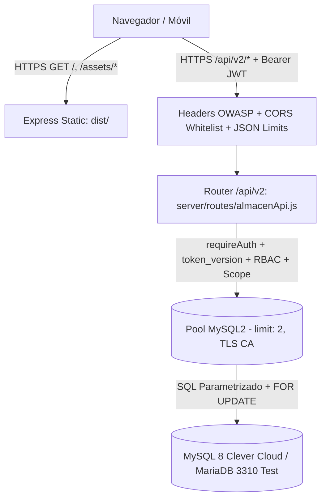
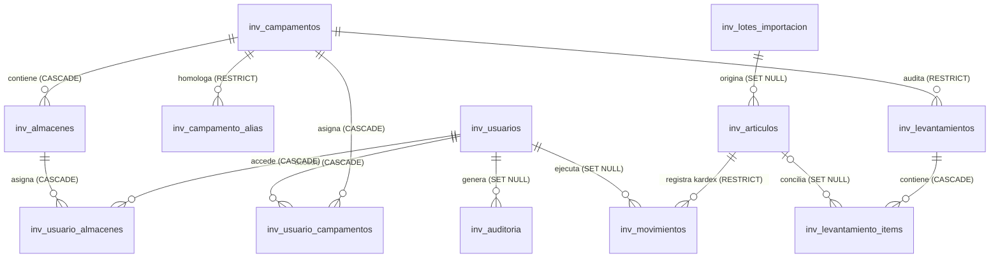

# INGMELEC | ALMACÉN GENERAL v2.1 — Documentación Técnica Integral

**Fecha de auditoría:** 16 de noviembre de 2026  
**Repositorio:** `RonnyAlmonte-19/INGMELEC-DOMINICANA` (rama `main`, commit `468937e`)  
**Nota de versiones:** Aunque el proyecto opera funcionalmente como **v2.1**, `package.json` y `server/package.json` declaran `"version": "2.0.0"`.

---

## 1. Inventario del Proyecto (Fase 1)

### 1.1 Objetivo y Stack Tecnológico Verificado
Sistema integral de gestión de inventario, movimientos, sedes/campamentos, levantamientos físicos y auditoría para **INGMELEC DOMINICANA**.

| Capa | Tecnología | Versión verificada (`package.json`) | Propósito |
| :--- | :--- | :--- | :--- |
| Frontend UI | React + React DOM | `^19.2.6` | Interfaz SPA modular con carga diferida (`React.lazy`) |
| Bundler | Vite + `@vitejs/plugin-react` | `^8.0.12` / `^6.0.1` | Compilación de producción (`dist/`) y proxy dev `/api` |
| Estilos | TailwindCSS + PostCSS + Autoprefixer | `^3.4.17` / `^8.5.15` / `^10.5.0` | Diseño responsive, tema `industrial` y `@media print` |
| Gráficos e Iconos | Recharts / Lucide React / Framer Motion | `^3.8.1` / `^1.16.0` / `^12.40.0` | Gráficos de Dashboard e iconografía |
| Excel/CSV Cliente | `read-excel-file` / `write-excel-file` | `^9.3.15` / `^4.1.1` | Lectura/exportación segura `.xlsx` y `.csv` (sin `xlsx`) |
| Backend API | Node.js (ESM) + Express + CORS + Morgan | Express `^4.21.2`, CORS `^2.8.5` | API REST `/api/v2`, seguridad HTTP y entrega de `dist/` |
| Criptografía | `argon2` + `node:crypto` | `^0.45.2` | Hashing Argon2id y JWT HS256 nativo |
| Base de Datos | `mysql2` (Promise pool) sobre MySQL 8 | `^3.22.3` | Persistencia relacional con TLS CA y transacciones ACID |
| Calidad | ESLint + `@eslint/js` + plugins React | `^10.3.0` | Análisis estático de código JS/JSX |

> **Nota:** `server/package.json` conserva `"xlsx": "^0.18.5"` sin uso en el código del servidor (hallazgo `SEC-06` / `DEBT-02`).

### 1.2 Estructura de Directorios Simplificada

```text
INGMELEC-DOMINICANA/
├── index.html                        # HTML raíz + listeners globales de error
├── package.json                      # Scripts dev/build/start/lint y deps frontend/root
├── vite.config.js                    # Proxy /api -> http://localhost:5000
├── tailwind.config.js                # Paleta corporativa industrial
├── eslint.config.js                  # Reglas ESLint para src/ y server/
├── .env.example / server/.env.example
├── docs/
│   ├── actualizaciones/              # Informes de etapas v2.1 y matriz de 34 hallazgos
│   └── auditorias/                   # Auditoría pre-v2.1 y documentación actual
├── src/
│   ├── App.jsx / main.jsx            # Router SPA manual (history.pushState), ErrorBoundary
│   ├── context/AppContext.jsx        # Estado global, sesión, apiFetch, catálogos, toasts
│   ├── components/
│   │   ├── common/                   # InventoryTable, ItemDetailModal, SearchableSelect, ErrorBoundary, IngmelecLogo
│   │   ├── layout/                   # Sidebar, Topbar
│   │   └── levantamientos/           # LevantamientoWorkspace
│   ├── pages/                        # 13 páginas (Login, Dashboard, 5 vistas Inventario, Movimientos, Ubicaciones, Levantamientos, Reportes, Auditoría, Usuarios)
│   └── utils/                        # permissions.js, jsonFormat.js, statusMapper.js, exportUtils.js
└── server/
    ├── index.js                      # Entrada Express, headers OWASP, static, CORS, límites JSON
    ├── package.json                  # Dependencias de producción del servidor
    ├── certs/clever-cloud-mysql-ca.pem
    ├── config/auth.js                # Validación obligatoria de JWT_SECRET (>=32 chars)
    ├── database/
    │   ├── db.js                     # Pool mysql2 (limit=2), TLS CA, MySQLWrapper
    │   ├── guard.js                  # Bloqueo estricto contra ejecución de pruebas en prod
    │   └── migrations/               # migration_01..06_safe, README_MIGRACIONES.md, rollback
    ├── routes/almacenApi.js          # Router monolítico con 49 endpoints /api/v2
    ├── scripts/recovery-developer.js # Recuperación controlada de cuenta developer
    └── tests/                        # Suite de 11 pruebas (no versionada en Git vía .gitignore)
```

### 1.3 Arquitectura General y Flujo de Datos



**Flujo UI -> MySQL:** `Page/Component` -> `AppContext.apiFetch` (inyecta JWT, intercepta `401`) -> `server/index.js` (headers, CORS, JSON limit 1MB/10MB) -> `requireAuth` (consulta `inv_usuarios` y verifica `activo` + `token_version`) -> `requirePermission` + `getUserAllowedCampamentos` -> transacción `pool.getConnection()` con `FOR UPDATE` y auditoría en `inv_auditoria`.

---

## 2. Análisis Funcional Completo (Fase 2)

| Módulo | Objetivo | Funciones principales | Archivos | Endpoints `/api/v2` | Tablas MySQL | Estado | Limitaciones conocidas |
| :--- | :--- | :--- | :--- | :--- | :--- | :--- | :--- |
| **Autenticación y Sesión** | Acceso seguro e identidad | Login Argon2id, `/me`, logout con revocación `token_version` | `LoginPage.jsx`, `AppContext.jsx`, `almacenApi.js` | `POST /auth/login`, `POST /auth/logout`, `GET /auth/me` | `inv_usuarios`, `inv_usuario_campamentos`, `inv_campamentos`, `inv_auditoria` | **Implementado** | JWT guardado en `localStorage`; rate limit solo en memoria y en `/login`. |
| **Dashboard General** | Visión ejecutiva en tiempo real | KPIs físicos, gráficos por área/estado, filtro sede/almacén, drill-down | `DashboardPage.jsx`, `Topbar.jsx` | `GET /dashboard/kpis`, `GET /config/entorno` | `inv_articulos`, `inv_campamentos`, `inv_almacenes`, `inv_levantamientos` | **Implementado** | No exporta gráficos como imagen ni personaliza widgets. |
| **Inventario Maestro y Áreas** | Catálogo y CRUD de bienes | Listado paginado/ordenable, alta con auto-código, edición, baja lógica (`activo=0`), ficha técnica/origen | `InventoryTable.jsx`, `ItemDetailModal.jsx`, `InventarioGeneralPage.jsx`, `InformaticaPage.jsx`, `OficinasPage.jsx`, `CocinaPage.jsx`, `AlmacenPage.jsx` | `GET /articulos`, `GET /articulos/next-code`, `GET /articulos/:id`, `POST /articulos`, `PUT /articulos/:id`, `DELETE /articulos/:id`, `/catalogos/*` | `inv_articulos`, `inv_categorias`, `inv_custodios`, `inv_movimientos`, `inv_auditoria` | **Implementado** | Sin edición masiva (bulk edit) desde tabla. |
| **Movimientos de Stock** | Kárdex inmutable de existencias | Alta de `ENTRADA`, `SALIDA`, `TRASLADO`, `ASIGNACION`, `DEVOLUCION`, `AJUSTE` con `FOR UPDATE` | `MovimientosPage.jsx`, `ItemDetailModal.jsx` | `GET /movimientos`, `POST /movimientos` | `inv_movimientos`, `inv_articulos`, `inv_campamentos`, `inv_almacenes`, `inv_custodios` | **Implementado** | `TRASLADO` mueve el registro completo (no divide cantidades parciales). Modal carga máx. 500 ítems en `<select>`. |
| **Campamentos, Almacenes y Alias** | Gestión territorial y homologación | CRUD sedes/bodegas, catálogo de alias, resolver alias, preview dry-run y aplicación atómica | `UbicacionesPage.jsx`, `LevantamientosPage.jsx` | `GET/POST /campamentos`, `PUT /campamentos/:id`, `POST /campamentos/:id/almacenes`, `GET/POST /campamentos/alias`, `POST /campamentos/resolver-alias`, `POST /campamentos/reasignaciones/preview|aplicar` | `inv_campamentos`, `inv_almacenes`, `inv_campamento_alias`, `inv_articulos`, `inv_movimientos` | **Implementado** | Sin coordenadas GPS/mapas interactivos. |
| **Levantamientos y Consolidación** | Auditoría física en campo y cierre ACID | Sesiones, captura rápida sticky, autocompletado, importación Excel/CSV, conciliación, consolidación atómica | `LevantamientosPage.jsx`, `LevantamientoWorkspace.jsx` | `GET/POST /levantamientos`, `GET/PUT /levantamientos/:id`, `GET /conciliacion`, `GET/POST/PUT/DELETE /items`, `POST /import-items`, `POST /consolidar` | `inv_levantamientos`, `inv_levantamiento_items`, `inv_articulos`, `inv_movimientos`, `inv_auditoria` | **Implementado** | Tabla de captura sin virtualización si supera >1,000 filas en cliente. |
| **Importación / Exportación y Reportes** | Análisis gerencial y salida de datos | Consolidado por sede/área, exportación hasta 10,000 filas (`.xlsx`/`.csv`) anti-CWE-1236, impresión | `ReportesPage.jsx`, `InventoryTable.jsx`, `exportUtils.js` | `GET /reportes/consolidado`, `GET /reportes/exportar` | `inv_articulos`, `inv_campamentos`, `inv_almacenes` | **Parcial (PDF)** | PDF depende de `window.print()` y `@media print`, sin generador PDF nativo. |
| **Usuarios y RBAC** | Administración de cuentas y permisos | Alta/edición, 20 permisos (18 checkboxes UI), reseteo de clave, toggle estado, revocación por `token_version` | `UsuariosPage.jsx`, `permissions.js` | `GET /usuarios/permisos-catalogo`, `GET/POST /usuarios`, `PUT /usuarios/:id`, `PATCH /usuarios/:id/estado`, `PUT /usuarios/:id/permisos`, `POST /usuarios/:id/recuperar`, `GET /usuarios/auditoria` | `inv_usuarios`, `inv_usuario_campamentos`, `inv_auditoria` | **Implementado** | Acceso exclusivo `developer`; sin creación de roles personalizados desde UI. |
| **Auditorías y Trazabilidad** | Cumplimiento ISO y forense | Consulta últimos 150 eventos, filtro reactivo y formato seguro anti-React #31 | `AuditoriaPage.jsx`, `jsonFormat.js` | `GET /auditoria` | `inv_auditoria`, `inv_articulos` | **Implementado** | Fijo en últimos 150 registros; sin paginación de servidor ni filtro de fechas. |
| **Hoja de Asignación** | Formato formal de entrega/devolución | Excluida de v2.1 por decisión de negocio | — | — | Base preparada (`inv_custodios`, `inv_movimientos`) | **Planificado** | Pendiente para versión futura. |

---

## 3. Arquitectura Frontend (Fase 3)

- **Navegación (`src/App.jsx`):** Enrutamiento SPA manual con `window.history.pushState`/`replaceState` y `popstate` (sin `react-router-dom`). Carga diferida (`React.lazy` + `Suspense`) de todas las páginas. Protección por ruta con pantallas dedicadas `403` y `404`.
- **Estado (`src/context/AppContext.jsx`):** Centraliza sesión (`ingmelec_token`, `ingmelec_user`, `ingmelec_active_campamento` en `localStorage`), `kpis`, `campamentosCatalog`, `entornoInfo`, `toast` y `apiFetch` (que limpia sesión automáticamente ante `HTTP 401`).
- **Resiliencia UI:** `ErrorBoundary.jsx` (raíz en `main.jsx` y `scoped` con `resetKey={activePage}` en `App.jsx`) + `jsonFormat.js` (`toSafeDisplayString`, `formatAuditDetails`) que erradican el React Error #31 ante objetos JSON devueltos por MySQL 8.
- **Responsive y Accesibilidad:** Sidebar fijo en `md:` colapsable (`80px`/`256px`) y Drawer deslizable con backdrop y tecla `Escape` en móvil (`< md`). Tablas envueltas en `overflow-x-auto`. Reglas `focus-visible` y `@media print` en `src/index.css`.
- **Deuda y duplicación detectada en frontend:**
  1. Wrappers casi idénticos en las 5 páginas de catálogo (`AlmacenPage`, `InformaticaPage`, `OficinasPage`, `CocinaPage`, `InventarioGeneralPage`).
  2. Lógica duplicada de exportación completa (`/reportes/exportar`) entre `InventoryTable.jsx` y `ReportesPage.jsx`.
  3. Normalización repetida de opciones de campamentos en `InventoryTable.jsx`, `Topbar.jsx` y `ReportesPage.jsx`.
  4. `<select>` nativo con hasta 500 artículos en `MovimientosPage.jsx` en lugar de usar `SearchableSelect` paginado/asíncrono.
  5. `innerHTML` en listeners de error de `index.html` (ver Auditoría de Seguridad).

---

## 4. Arquitectura Backend (Fase 4)

### 4.1 Orden de Middlewares en `server/index.js`
1. Validación síncrona pre-vuelo de `JWT_SECRET` (`validateAndGetJwtSecret()`, mínimo 32 caracteres).
2. `app.disable('x-powered-by')` y `app.set('trust proxy', resolveTrustProxy(...))` (por defecto `1`).
3. Encabezados OWASP (`X-Content-Type-Options: nosniff`, `X-Frame-Options: SAMEORIGIN`, `Referrer-Policy`, `Content-Security-Policy`, `Permissions-Policy`, `Strict-Transport-Security` en producción).
4. **Entrega de estáticos (`express.static(path.join(__dirname, '..', 'dist'))`)** — reubicada *antes* del filtro CORS en el hotfix `468937e` para evitar bloqueos `403` JSON sobre `/assets/*.js` y `.css` enviados con `crossorigin`.
5. Doble capa CORS: filtro estricto con `isOriginAllowed(origin)` (retorna `403` JSON si falla) + middleware `cors()`.
6. Límites JSON diferenciados: `10 MB` solo en 5 rutas de artículos/levantamientos con imágenes Base64 o lotes; `1 MB` global en el resto.
7. `GET /health`, interceptor `MAINTENANCE_MODE=true` (bloquea `POST`/`PUT`/`PATCH`/`DELETE` con `503`), montaje de `/api/v2`, bloqueo `404` de `/api` legado, fallback SPA `GET *` a `dist/index.html`, y manejador global de errores sin fugas de stack en producción.

### 4.2 Catálogo Completo de Endpoints (`/api/v2` — 49 rutas en `server/routes/almacenApi.js`)

| # | Método | Ruta (`/api/v2/...`) | Finalidad | Permisos / Rol | Tablas principales |
|---|---|---|---|---|---|
| 1 | POST | `/auth/login` | Login Argon2id + JWT + `rateLimitLogin` | Público | `inv_usuarios`, `inv_usuario_campamentos`, `inv_campamentos` |
| 2 | POST | `/auth/logout` | Logout y `bumpUserTokenVersion` | `requireAuth` | `inv_usuarios`, `inv_auditoria` |
| 3 | GET | `/auth/me` | Perfil, permisos y sedes del usuario | `requireAuth` | `inv_usuarios`, `inv_usuario_campamentos`, `inv_campamentos` |
| 4 | GET | `/config/entorno` | Indicador Pruebas vs Producción | `requireAuth` | — |
| 5 | GET | `/dashboard/kpis` | Métricas globales y por área/sede | `dash:ver` | `inv_articulos`, `inv_campamentos`, `inv_almacenes`, `inv_levantamientos` |
| 6 | GET | `/articulos/next-code` | Siguiente código correlativo por área | `inv:crear` | `inv_articulos`, `inv_levantamiento_items` |
| 7 | GET | `/articulos` | Listado paginado, filtrado y ordenado | `inv:ver` (+ scope) | `inv_articulos`, `inv_campamentos`, `inv_almacenes` |
| 8 | GET | `/articulos/:id` | Detalle + historial de movimientos | `inv:ver` (+ scope) | `inv_articulos`, `inv_movimientos`, `inv_usuarios` |
| 9 | POST | `/articulos` | Alta transaccional con `FOR UPDATE` | `inv:crear` (+ scope) | `inv_articulos`, `inv_movimientos`, `inv_auditoria` |
| 10 | PUT | `/articulos/:id` | Edición transaccional con `FOR UPDATE` | `inv:editar` (+ scope) | `inv_articulos`, `inv_movimientos`, `inv_auditoria` |
| 11 | DELETE | `/articulos/:id` | Baja lógica (`activo = 0`) | `inv:eliminar` (+ scope) | `inv_articulos`, `inv_auditoria` |
| 12 | GET | `/movimientos` | Historial paginado del kárdex | `inv:movimientos_ver` (+ scope) | `inv_movimientos`, `inv_articulos`, `inv_campamentos` |
| 13 | POST | `/movimientos` | Registro atómico de movimiento | `inv:movimientos_registrar` (+ scope) | `inv_movimientos`, `inv_articulos`, `inv_auditoria` |
| 14 | GET | `/reportes/consolidado` | Consolidado ejecutivo por área/sede | `rep:ver` (+ scope) | `inv_articulos`, `inv_campamentos` |
| 15 | GET | `/reportes/exportar` | Exportación filtrada hasta 10,000 filas | `rep:exportar` (+ scope) | `inv_articulos`, `inv_campamentos`, `inv_almacenes` |
| 16 | GET | `/auditoria` | Bitácora de auditoría | `aud:ver` o developer | `inv_auditoria`, `inv_articulos` |
| 17 | GET | `/usuarios/permisos-catalogo` | Catálogo de claves de permiso | Developer | — |
| 18 | GET | `/usuarios` | Listado de usuarios y sedes | Developer | `inv_usuarios`, `inv_usuario_campamentos` |
| 19 | POST | `/usuarios` | Alta de usuario (prohíbe crear developer) | Developer | `inv_usuarios`, `inv_usuario_campamentos`, `inv_auditoria` |
| 20 | PUT | `/usuarios/:id` | Edición usuario + revocación token | Developer | `inv_usuarios`, `inv_usuario_campamentos`, `inv_auditoria` |
| 21 | PATCH | `/usuarios/:id/estado` | Activar/desactivar + revocación token | Developer | `inv_usuarios`, `inv_auditoria` |
| 22 | PUT | `/usuarios/:id/permisos` | Actualizar `permisos_json` + revocación | Developer | `inv_usuarios`, `inv_auditoria` |
| 23 | POST | `/usuarios/:id/recuperar` | Reseteo de contraseña + revocación | Developer | `inv_usuarios`, `inv_auditoria` |
| 24 | GET | `/usuarios/auditoria` | Auditoría filtrada de usuarios | Developer | `inv_auditoria` |
| 25 | GET | `/campamentos` | Listado de sedes, almacenes y stock | `camp:ver` (+ scope) | `inv_campamentos`, `inv_almacenes`, `inv_articulos` |
| 26 | POST | `/campamentos` | Alta de sede + almacén principal | `camp:operar` | `inv_campamentos`, `inv_almacenes`, `inv_auditoria` |
| 27 | GET | `/campamentos/alias` | Catálogo de alias territoriales | `camp:ver` (+ scope) | `inv_campamento_alias`, `inv_campamentos` |
| 28 | POST | `/campamentos/alias` | Registrar/homologar alias | `camp:operar` | `inv_campamento_alias`, `inv_auditoria` |
| 29 | POST | `/campamentos/resolver-alias` | Resolución heurística de ubicación | `camp:ver` | `inv_campamentos`, `inv_campamento_alias` |
| 30 | POST | `/campamentos/reasignaciones/preview` | Simulación dry-run de reasignación | `camp:operar` (+ scope) | `inv_articulos`, `inv_campamentos`, `inv_campamento_alias` |
| 31 | POST | `/campamentos/reasignaciones/aplicar` | Reasignación transaccional de sedes | `camp:operar` (+ scope) | `inv_articulos`, `inv_movimientos`, `inv_auditoria` |
| 32 | PUT | `/campamentos/:id` | Editar sede (bloquea baja si tiene stock) | `camp:operar` | `inv_campamentos`, `inv_articulos`, `inv_auditoria` |
| 33 | POST | `/campamentos/:id/almacenes` | Alta de almacén en sede | `camp:operar` | `inv_campamentos`, `inv_almacenes`, `inv_auditoria` |
| 34 | GET | `/catalogos/categorias` | Listado unificado de categorías | Lectura autenticado | `inv_categorias`, `inv_articulos` |
| 35 | POST | `/catalogos/categorias` | Alta formal de categoría | `inv:crear` | `inv_categorias`, `inv_auditoria` |
| 36 | GET | `/catalogos/custodios` | Listado unificado de custodios | Lectura autenticado | `inv_custodios`, `inv_articulos` |
| 37 | POST | `/catalogos/custodios` | Alta formal de custodio | `inv:crear` | `inv_custodios`, `inv_auditoria` |
| 38 | GET | `/catalogos/ubicaciones` | Sedes y ubicaciones activas | Lectura autenticado (+ scope) | `inv_campamentos`, `inv_articulos` |
| 39 | GET | `/levantamientos` | Listado de sesiones | `lev:ver` (+ scope) | `inv_levantamientos`, `inv_campamentos` |
| 40 | POST | `/levantamientos` | Apertura de sesión | `lev:crear` (+ scope) | `inv_levantamientos`, `inv_auditoria` |
| 41 | GET | `/levantamientos/:id` | Detalle de sesión | `lev:ver` (+ scope) | `inv_levantamientos`, `inv_campamentos` |
| 42 | GET | `/levantamientos/:id/conciliacion` | Comparativa capturado vs maestro | `lev:ver` (+ scope) | `inv_levantamiento_items`, `inv_articulos` |
| 43 | PUT | `/levantamientos/:id` | Editar cabecera (no si Finalizado/Cancelado) | `lev:editar` (+ scope) | `inv_levantamientos`, `inv_auditoria` |
| 44 | GET | `/levantamientos/:id/items` | Ítems capturados en la sesión | `lev:ver` (+ scope) | `inv_levantamiento_items` |
| 45 | POST | `/levantamientos/:id/items` | Captura individual en sesión | `lev:capturar` (+ scope) | `inv_levantamiento_items`, `inv_auditoria` |
| 46 | PUT | `/levantamientos/:id/items/:itemId` | Edición de ítem en borrador | `lev:editar` (+ scope) | `inv_levantamiento_items`, `inv_auditoria` |
| 47 | DELETE | `/levantamientos/:id/items/:itemId` | Borrado de ítem en borrador | `lev:editar` (+ scope) | `inv_levantamiento_items`, `inv_auditoria` |
| 48 | POST | `/levantamientos/:id/import-items` | Carga masiva por lotes (máx. 5,000, chunks 500) | `lev:importar` (+ scope) | `inv_levantamiento_items`, `inv_auditoria` |
| 49 | POST | `/levantamientos/:id/consolidar` | Consolidación atómica ACID al maestro | `lev:consolidar` (+ scope) | `inv_levantamientos`, `inv_levantamiento_items`, `inv_articulos`, `inv_movimientos`, `inv_auditoria` |

---

## 5. Base de Datos MySQL y Migraciones v2.1 (Fase 5)

### 5.1 Conexión y Guardián (`db.js` y `guard.js`)
- `server/database/db.js`: Pool `mysql2/promise` con `connectionLimit: 2` (fijo en código para respetar el tope de 5 conexiones de Clever Cloud), `multipleStatements: false` en el pool operativo, y TLS obligatorio (`rejectUnauthorized: true`) usando `server/certs/clever-cloud-mysql-ca.pem` cuando `DB_SSL=true`.
- `server/database/guard.js`: Bloquea cualquier intento de ejecutar pruebas o scripts destructivos contra `clever-cloud.com`, `cleverapps.io` o la base `gridops_enterprise`.

### 5.2 Diagrama Entidad-Relación



### 5.3 Inventario de las 14 Tablas
1. `inv_usuarios` (PK `id`, `UNIQUE(email)`, `token_version`, `permisos_json`, soft delete `activo`)
2. `inv_lotes_importacion` (PK `id`, FK `usuario_id`)
3. `inv_articulos` (PK `id`, índices en `codigo_original`, `serie_imei`, `ubicacion_nombre`, `area`, `categoria`, `idx_art_filtro_compuesto`, soft delete `activo`, `es_sintetico`)
4. `inv_movimientos` (PK `id`, FK `articulo_id` **ON DELETE RESTRICT**, `idx_mov_sint_fecha`, kárdex append-only)
5. `inv_auditoria` (PK `id`, FK `usuario_id`, `detalles_previos`/`detalles_nuevos` JSON, `idx_inv_aud_entidad`)
6. `inv_campamentos` (PK `id`, `UNIQUE(nombre)`, `clasificacion_sede`, soft delete `activo`)
7. `inv_almacenes` (PK `id`, FK `campamento_id` CASCADE, `estado_verificacion`, soft delete `activo`)
8. `inv_levantamientos` (PK `id`, `UNIQUE(codigo_levantamiento)`, FKs `campamento_id` RESTRICT, `creado_por` RESTRICT)
9. `inv_levantamiento_items` (PK `id`, FK `levantamiento_id` CASCADE, `articulo_maestro_id` SET NULL, flag `consolidado`)
10. `inv_categorias` (PK `id`, `UNIQUE uk_area_categoria(area, nombre)`, soft delete `activo`)
11. `inv_custodios` (PK `id`, `UNIQUE(nombre)`, `departamento`, `telefono`, soft delete `activo`)
12. `inv_usuario_campamentos` (PK `id`, `UNIQUE(usuario_id, campamento_id)`, CASCADE)
13. `inv_usuario_almacenes` (PK `id`, `UNIQUE(usuario_id, almacen_id)`, CASCADE)
14. `inv_campamento_alias` (PK `id`, `UNIQUE uk_alias_normalizado`, FK `campamento_id` RESTRICT)

### 5.4 Auditoría de Migraciones Seguras v2.1 y Preservación Histórica
- **`migration_03_v21_seguridad_y_esquema.sql`:** Idempotente vía `information_schema` + `PREPARE/EXECUTE`. Añade `token_version`, amplía ENUMs de `inv_almacenes`, `inv_campamentos`, `inv_articulos` y `inv_levantamientos`, y añade `departamento`/`telefono` a `inv_custodios`.
- **`migration_04_v21_campamentos_alias.sql`:** Crea `inv_campamento_alias` y siembra alias para `ALM-27FEB`, `CAMP-OPL` y `CAMP-M633` usando `INSERT IGNORE` y resolución dinámica por código/nombre normalizado (sin IDs fijos `3/12/13`). **Cero `UPDATE` sobre `inv_articulos`.**
- **`migration_05_v21_adapted.sql`:** Sustituye a `deprecated_migration_05...disabled` (que sobrescribía `permisos_json`). Realiza validación de solo lectura con `JSON_VALID(permisos_json)` preservando intactos los roles y permisos reales.
- **`migration_06_v21_safe.sql`:** Sustituye a `deprecated_migration_06...disabled` (que forzaba `campamento_id = NULL` en artículos sin coincidencia directa). Endurece `inv_movimientos.articulo_id` con `ON DELETE RESTRICT` e índices compuestos, **sin imponer FK destructiva sobre `inv_articulos.campamento_id` / `almacen_id`**, protegiendo así los registros históricos (15 ítems históricos de OPL/M633 y 104 de `KM 19 AUT DUARTE` con `SEDE_AMBIGUA`).

### 5.5 Riesgos de Concurrencia y Rollback
- Aunque `SELECT ... FOR UPDATE` protege creación, edición, movimientos y consolidación contra *race conditions* de stock negativo, `generateNextCodeForArea` (`LIKE ? FOR UPDATE`) y el bloqueo `IN (?) FOR UPDATE` de seriales sin orden determinista en consolidaciones concurrentes pueden generar contención o deadlocks transitorios bajo alta concurrencia, agravados por `connectionLimit: 2`.
- En MySQL los DDL (`ALTER TABLE`, `DROP INDEX`) hacen `COMMIT` implícito; el rollback depende de snapshots previos (`rollback_clever_cloud_produccion.sql`).

---

## 6. Despliegue, Operación y Calidad (Fases 7 y 8)

### 6.1 GitHub, Render y Clever Cloud
- **GitHub:** `RonnyAlmonte-19/INGMELEC-DOMINICANA`, rama productiva `main`. Integración v2.1 en `f2ebf7b` y hotfix de estáticos antes de CORS en `468937e`.
- **Render (Contexto conocido / panel externo NO VERIFICADO en vivo):** Auto-Deploy `Off`; Build Command `npm install --include=dev && npm install --prefix server && npm run build`; Start Command `npm run start`.
- **Variables de entorno requeridas (solo nombres):** `PORT`, `NODE_ENV`, `MAINTENANCE_MODE`, `DB_HOST`, `DB_PORT`, `DB_USER`, `DB_PASSWORD`, `DB_NAME`, `DB_SSL`, `DB_SSL_ALLOW_INSECURE`, `DB_CONNECTION_LIMIT`, `CORS_ORIGINS`, `TRUST_PROXY`, `JWT_SECRET`, `JWT_TTL_HOURS`.
- **Clever Cloud:** Conexión MySQL 8 con TLS CA obligatorio (`DB_SSL=true`) y límite de pool `2`.

### 6.2 Pruebas Ejecutadas en Esta Auditoría vs. Cobertura Histórica
- **Ejecutado en esta auditoría (16/11/2026 / sesión actual):**
  - `npm.cmd run build`: **PASS** (`vite build`, `dist/` generado).
  - `node --check server/index.js`: **PASS**.
  - `npm.cmd run lint`: **FAIL (código 1)** — `server/index.js` limpio, pero reporta **7 errores** en `server/scripts/*.js` (`no-useless-escape`, `no-useless-assignment`) y **54 warnings** en `src/`.
  - `node --test server/tests/etapa01_isolation_qa.test.mjs`: **1 PASS / 2 FAIL en sandbox** (fallo 1 por esperar rama `develop/almacen-v2.1` estando en `main`; fallo 2 por timeout conectando a `127.0.0.1:3310` debido a restricción de loopback TCP del sandbox).
- **Suite existente en `server/tests/` (11 archivos, no ejecutada íntegramente en esta sesión):** `etapa01`..`etapa08`, `e2e_playwright_cdp_disposable.mjs`, `e2e_production_migration_validation.mjs` (basadas en MariaDB `3310` + shim MySQL 8 JSON + Chromium CDP).
- **Pruebas críticas faltantes:** Pruebas unitarias React (Vitest/RTL), pruebas de carga/concurrencia sobre `connectionLimit: 2`, simulación de caída/reconexión de MySQL a mitad de transacción, prueba automatizada de `MAINTENANCE_MODE=true` y compatibilidad cross-browser (Firefox/WebKit).
